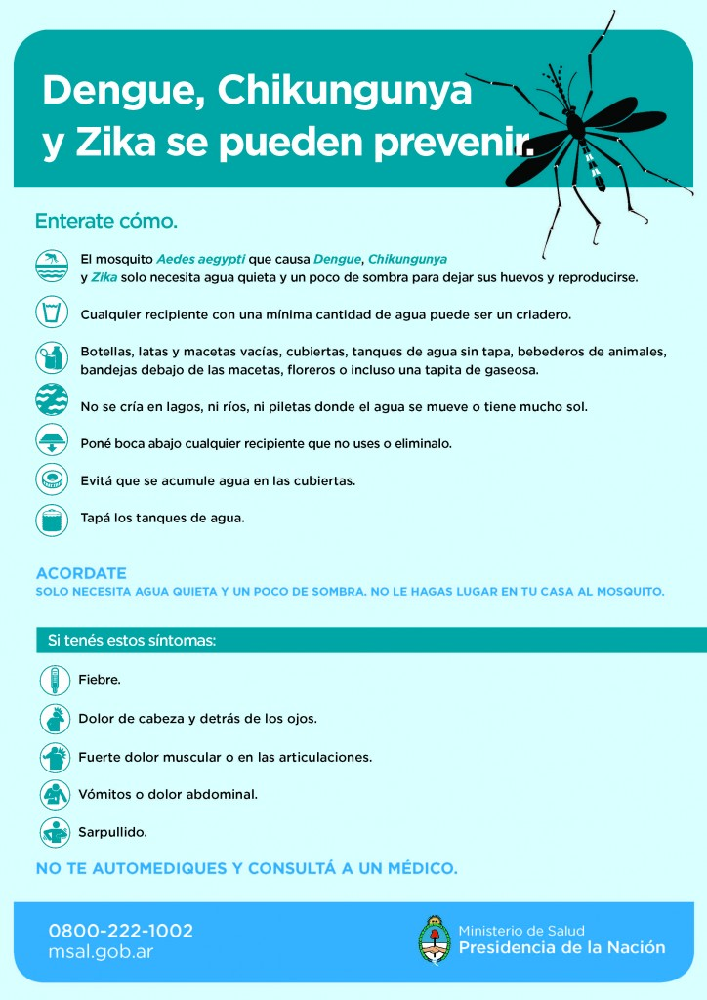

Compartimos material del Ministerio de Salud de la Nación sobre la prevención de Dengue, Chikungunya y Zika, enfermedades transmitidas por el mosquito *Aedes aegypti*.

Este mosquito solo necesita agua quieta y un poco de sombra para poner sus huevos, por lo que cualquier recipiente con una mínima cantidad de agua puede convertirse en un criadero: botellas, latas, macetas, cubiertas, tanques sin tapa, bebederos de animales, floreros o incluso una tapita de gaseosa. En cambio, no se cría en lagos, ríos ni piletas donde el agua se mueve o recibe mucho sol.

Para prevenirlo, es importante dar vuelta o eliminar los recipientes que no se usan, evitar que se acumule agua en las cubiertas y mantener tapados los tanques de agua.

Ante síntomas como fiebre, dolor de cabeza y detrás de los ojos, dolor muscular o articular intenso, vómitos, dolor abdominal o sarpullido, se recomienda no automedicarse y consultar a un médico.

Más información en msal.gob.ar o al 0800-222-1002.

