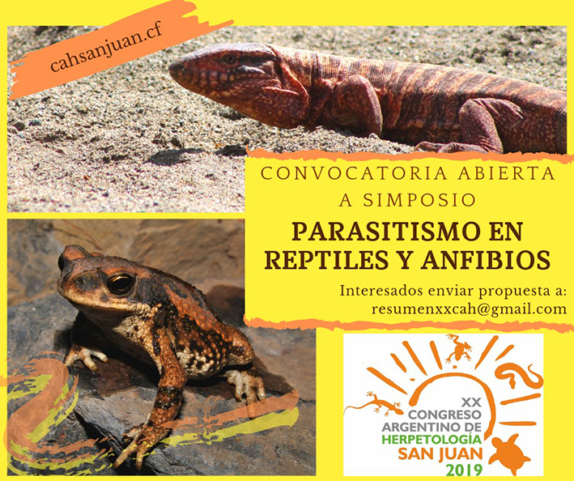

El XX Congreso Argentino de Herpetología, que se realizará en San Juan en 2019, abrió la convocatoria para participar del simposio “Parasitismo en reptiles y anfibios”.

El simposio será un espacio de encuentro entre la herpetología y la parasitología, y una oportunidad para que investigadores y estudiantes de nuestra comunidad presenten sus trabajos sobre los parásitos de estos grupos de vertebrados.

Quienes deseen participar pueden enviar sus propuestas a resumenxxcah@gmail.com. 

Desde la APA invitamos a todos los socios que trabajan en esta temática a sumarse a la convocatoria.

