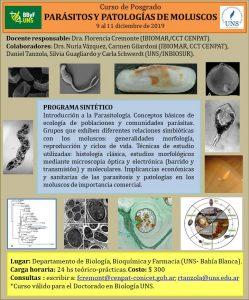

Del 9 al 11 de diciembre de 2019 se dictará en Bahía Blanca el curso de posgrado “Parásitos y patologías de moluscos”, en el Departamento de Biología, Bioquímica y Farmacia de la Universidad Nacional del Sur (UNS).

La docente responsable será la Dra. Florencia Cremonte (IBIOMAR, CCT CENPAT). Colaborarán las Dras. Nuria Vázquez y Carmen Gilardoni (IBIOMAR, CCT CENPAT), y Daniel Tanzola, Silvia Guagliardo y Carla Schwerdt (UNS/INBIOSUR).

**Contenidos**
El curso comienza con una introducción a la parasitología y a los conceptos básicos de ecología de poblaciones y comunidades parásitas. Luego aborda los grupos que establecen relaciones simbióticas con los moluscos: sus características generales, morfología, reproducción y ciclos de vida.
También se presentarán las técnicas de estudio que se usan en esta área, como la histología clásica, la microscopía óptica y electrónica (de barrido y de transmisión) y las herramientas moleculares. Por último, se analizarán las implicancias económicas y sanitarias de los parásitos y las patologías en moluscos de importancia comercial.

**Datos del curso**
Fecha: 9, 10 y 11 de diciembre de 2019
Lugar: Departamento de Biología, Bioquímica y Farmacia, UNS, Bahía Blanca
Carga horaria: 24 horas teórico-prácticas
Costo: $300
El curso es válido para el Doctorado en Biología de la UNS.

Consultas e inscripción: Florencia Cremonte (fcremont@cenpat-conicet.gob.ar) y Daniel Tanzola (rtanzola@uns.edu.ar)

