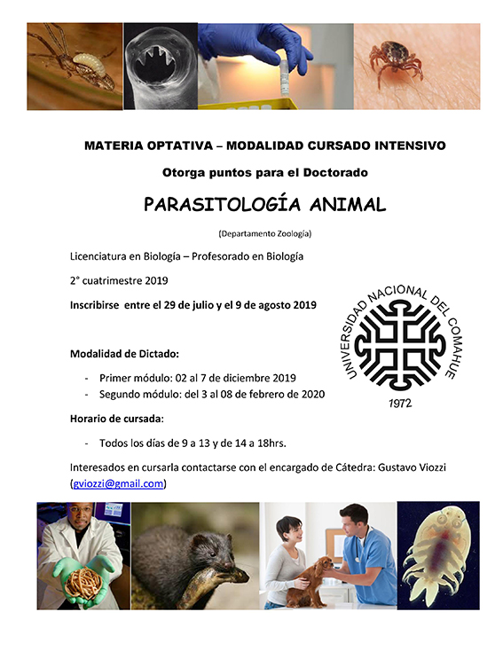

El Departamento de Zoología de la Universidad Nacional del Comahue dictará en Bariloche la materia “Parasitología Animal”, en modalidad de cursado intensivo. Es una materia optativa de la Licenciatura y el Profesorado en Biología, y también se ofrece como curso de posgrado con puntos para el Doctorado.

Inscripción: del 29 de julio al 9 de agosto de 2019.

Cursada

El curso se divide en dos módulos de una semana, con clases todos los días de 9 a 13 y de 14 a 18 h:

Primer módulo (2 al 7 de diciembre de 2019): simbiosis y parasitismo, diversidad de grupos parásitos, ciclos de vida y tipos de transmisión, ecología de poblaciones y comunidades parásitas, parasitismo en la fauna silvestre de Patagonia y conservación del parasitismo.
Segundo módulo (3 al 8 de febrero de 2020): zoonosis terrestres y acuáticas, epidemiología y parásitos de importancia en ganadería.

La propuesta combina clases teóricas, trabajos prácticos con observación de parásitos vivos y disección de hospedadores, infecciones experimentales y seminarios. También incluye charlas de especialistas, trabajo de campo con muestreo de heces caninas en ambientes urbanos y técnicas de determinación molecular. Cada módulo termina con un examen escrito.

El detalle día por día está en el [cronograma tentativo](/assets/docs/CRONOGRAMA-TENTATIVO.pdf).

Contacto: los interesados pueden escribir al encargado de Cátedra, Gustavo Viozzi (gviozzi@gmail.com).

