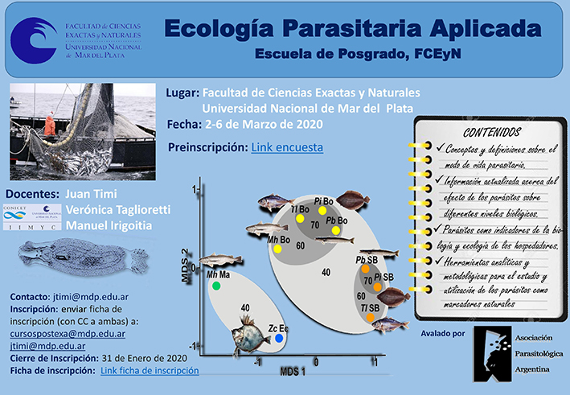

Del 2 al 6 de marzo de 2020, la Escuela de Posgrado de la Facultad de Ciencias Exactas y Naturales (FCEyN) de la Universidad Nacional de Mar del Plata dictará el curso “Ecología Parasitaria Aplicada”. El curso es gratuito y cuenta con el aval de la Asociación Parasitológica Argentina.

Estará a cargo de los Dres. Juan Timi, Verónica Tagliorretti y Manuel Irigoitia, del Instituto de Investigaciones Marinas y Costeras (IIMyC, CONICET–UNMdP).

**Contenidos**

Conceptos y definiciones sobre el modo de vida parasitario.
Información actualizada sobre el efecto de los parásitos en distintos niveles biológicos.
Los parásitos como indicadores de la biología y la ecología de sus hospedadores.
Herramientas analíticas y metodológicas para estudiar y usar a los parásitos como marcadores naturales.

**Inscripción**

Completar la preinscripción mediante el [formulario](https://docs.google.com/forms/d/18XTENlKWCAPgMcQJRIozQocEFAVg9n002yuVgOlxonQ/viewform?ts=5d2c000a&edit_requested=true).
Enviar la ficha de inscripción a cursospostexa@mdp.edu.ar, con copia a jtimi@mdp.edu.ar.

La inscripción cierra el 31 de enero de 2020.

Lugar: Facultad de Ciencias Exactas y Naturales, Universidad Nacional de Mar del Plata.

Consultas: Dr. Juan Timi (jtimi@mdp.edu.ar)

