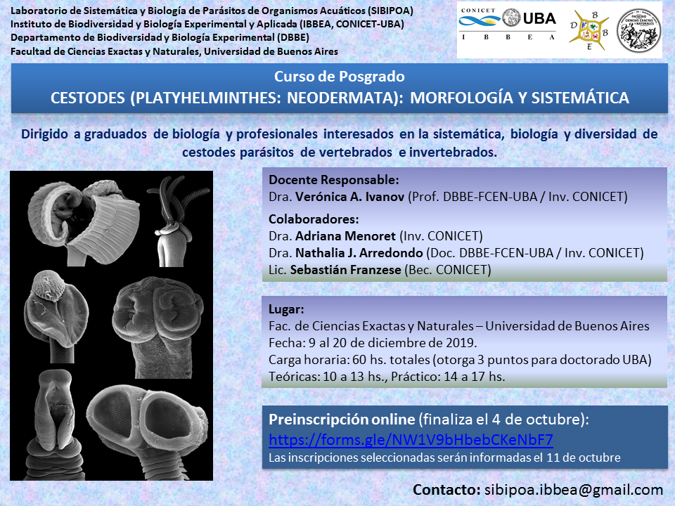

Del **9 al 20 de diciembre de 2019** se dictará en la Facultad de Ciencias Exactas y Naturales de la UBA el curso de posgrado **«Cestodes (Platyhelminthes: Neodermata): morfología y sistemática»**, organizado por el Laboratorio de Sistemática y Biología de Parásitos de Organismos Acuáticos (SIBIPOA, IBBEA, CONICET-UBA).

Los cestodes son parásitos de vertebrados e invertebrados en muy diversos ambientes y tienen una gran relevancia ecológica y sanitaria. El curso propone un recorrido completo por el grupo: su morfología funcional, el tegumento y los microtricos, los sistemas reproductores, los ciclos de vida, los hospedadores y las vías de transmisión, su clasificación y filogenia, y su uso como bioindicadores.

## Teoría y práctica en partes iguales

La propuesta es mitad teórica y mitad práctica. En el laboratorio, quienes participen aprenderán técnicas de colección, fijación y procesamiento de cestodes, y trabajarán en la observación e identificación de ejemplares de los distintos órdenes.

- **Docente responsable:** Dra. Verónica A. Ivanov (DBBE-FCEN-UBA / CONICET).
- **Colaboradores:** Dra. Adriana Menoret, Dra. Nathalia J. Arredondo y Lic. Sebastián Franzese.
- **Dirigido a:** graduados de Biología y profesionales de otras áreas interesados en la biología, diversidad y sistemática de cestodes.
- **Carga horaria:** 60 horas en 10 días, con evaluación final. Otorga 3 puntos para el doctorado de la UBA.
- **Horario:** teóricas de 10 a 13 h y prácticos de 14 a 17 h.
- **Contacto:** sibipoa.ibbea@gmail.com

[Programa completo del curso aquí](/assets/docs/programa-curso-cestodes-2019.pdf)
