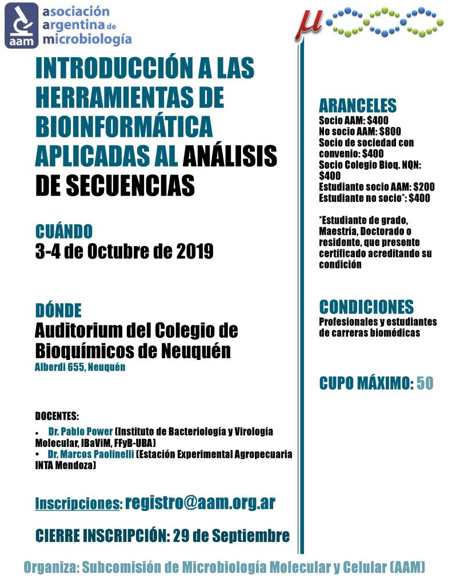

La **Asociación Argentina de Microbiología (AAM)** y el **Colegio de Bioquímicos de Neuquén** organizan el taller **«Introducción a las herramientas de bioinformática aplicadas al análisis de secuencias»**, que se realizará el **3 y 4 de octubre de 2019** en el auditorio del Colegio de Bioquímicos de Neuquén (Alberdi 655).

Una oportunidad para dar los primeros pasos en el análisis de secuencias de la mano de especialistas en microbiología molecular.

## Docentes

- **Dr. Pablo Power**, Instituto de Bacteriología y Virología Molecular (IBaViM, FFyB-UBA).
- **Dr. Marcos Paolinelli**, Estación Experimental Agropecuaria INTA Mendoza.

## Aranceles

- Socios de la AAM: $400
- No socios: $800
- Socios de sociedades con convenio: $400
- Estudiantes socios de la AAM: $200
- Estudiantes no socios: $400 (estudiantes de grado, maestría, doctorado o residencia, con certificado)

**Cupo máximo: 50 personas.** La inscripción cierra el **29 de septiembre** y se realiza exclusivamente por correo a registro@aam.org.ar o desde la [web de la AAM](https://www.aam.org.ar).
