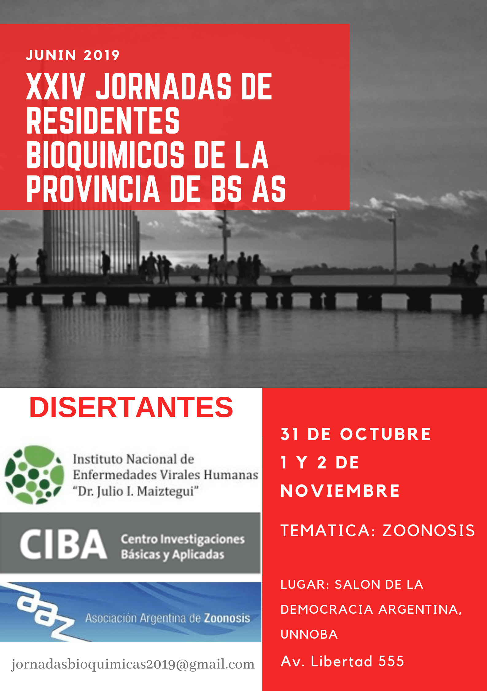

Del **31 de octubre al 2 de noviembre de 2019**, Junín será sede de las **XXIV Jornadas de Residentes Bioquímicos de la Provincia de Buenos Aires**. Este año la temática central son las **zoonosis**, y las actividades se desarrollarán en el Salón de la Democracia Argentina de la UNNOBA.

Las jornadas son organizadas por la Residencia de Bioquímica Clínica del HIGA «Dr. A. Piñeyro» de Junín, con la participación de la Asociación Argentina de Zoonosis (AAZ).

## Programa del módulo de zoonosis

**Viernes 1 de noviembre**

- 10:00 a 11:00 — Apertura a cargo de directivos de la AAZ (Dres. P. Martino y J. L. Molfese).
- 11:00 a 12:00 — Panorama actual de las zoonosis en el país y la región (Dr. E. Guarnera, presidente de la AAZ, OPS, Instituto Malbrán).
- 12:00 a 13:00 — Una sola salud (Dr. R. Durlach, Hospital Alemán, ITAE).
- 14:00 a 15:30 — Brucelosis (S. Escobar, Instituto Malbrán).
- 15:30 a 17:00 — Presentación de trabajos de investigación de los residentes.

**Sábado 2 de noviembre**

- 8:00 a 9:00 — Toxoplasmosis (M. Messina, Hospital Alemán).
- 9:00 a 10:30 — Mesa redonda con expertos de la AAZ.

**Consultas:** jornadasbioquimicas2019@gmail.com
