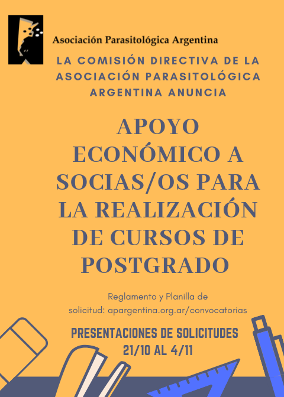

La Comisión Directiva de la **Asociación Parasitológica Argentina** anuncia una nueva convocatoria de **apoyo económico para socias y socios que deseen realizar cursos de posgrado**.

La iniciativa busca acompañar la formación académica continua de quienes integran la Asociación, ayudando a cubrir los gastos de capacitación.

## Fechas y requisitos

- **Presentación de solicitudes:** del **21 de octubre al 4 de noviembre de 2019**.
- **Reglamento y planilla de solicitud:** disponibles en la sección [Convocatorias](https://apargentina.org.ar/convocatorias/apoyo-economico-cursos-de-postgrado/).
