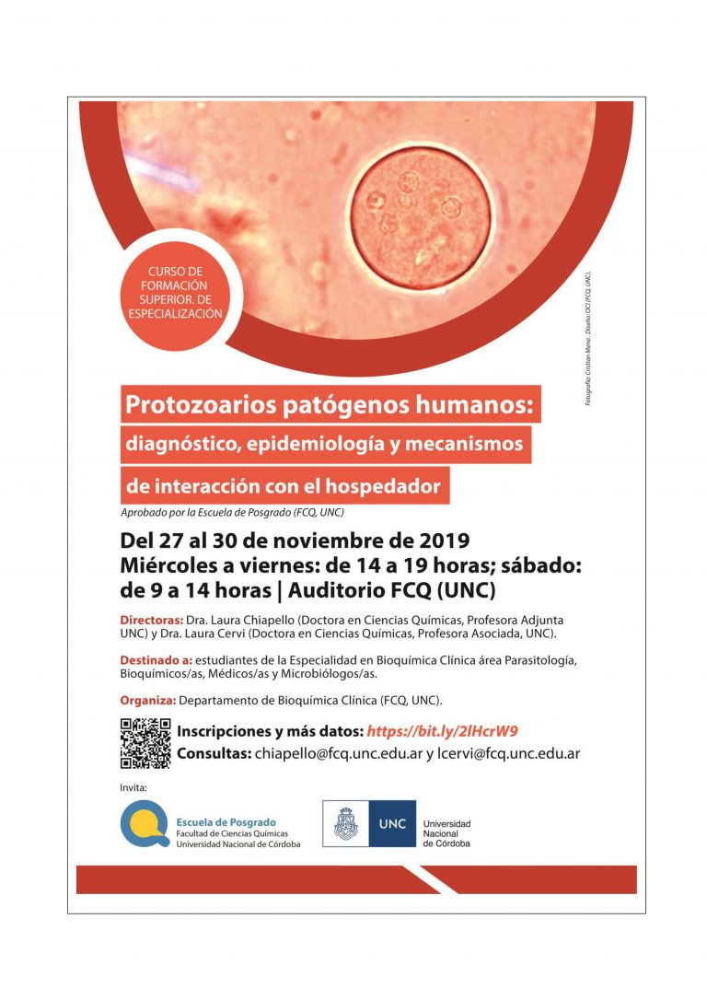
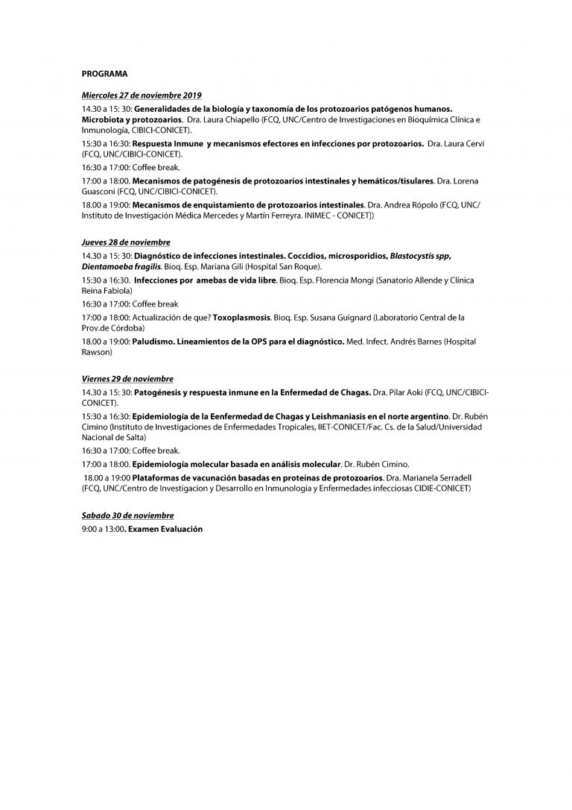

El Departamento de Bioquímica Clínica de la **Facultad de Ciencias Químicas de la UNC** invita al curso de posgrado y especialización **«Protozoarios patógenos humanos: diagnóstico, epidemiología y mecanismos de interacción con el hospedador»**, que se dictará del **27 al 30 de noviembre de 2019** en el auditorio de la FCQ.

Dirigen el curso la **Dra. Laura Chiapello** y la **Dra. Laura Cervi**. Está destinado a estudiantes de la Especialidad en Bioquímica Clínica (área Parasitología), bioquímicos, médicos y microbiólogos, y cuenta con la aprobación de la Escuela de Posgrado de la FCQ.

## Programa

**Miércoles 27:** biología y taxonomía de los protozoarios patógenos y su relación con la microbiota; respuesta inmune; mecanismos de patogénesis de protozoarios intestinales y hemáticos; enquistamiento de protozoarios intestinales.

**Jueves 28:** diagnóstico de infecciones intestinales (coccidios, microsporidios, *Blastocystis* spp., *Dientamoeba fragilis*); amebas de vida libre; actualización en toxoplasmosis; lineamientos de la OPS para el diagnóstico de paludismo.

**Viernes 29:** patogénesis y respuesta inmune en la enfermedad de Chagas; epidemiología de Chagas y leishmaniasis en el norte argentino; epidemiología molecular; plataformas de vacunación basadas en proteínas de protozoarios.

**Sábado 30:** evaluación final.

- **Horario:** de miércoles a viernes, de 14 a 19 h; sábado, de 9 a 14 h.
- **Inscripciones y más datos:** [bit.ly/2lHcrW9](https://bit.ly/2lHcrW9)
- **Consultas:** chiapello@fcq.unc.edu.ar y lcervi@fcq.unc.edu.ar
