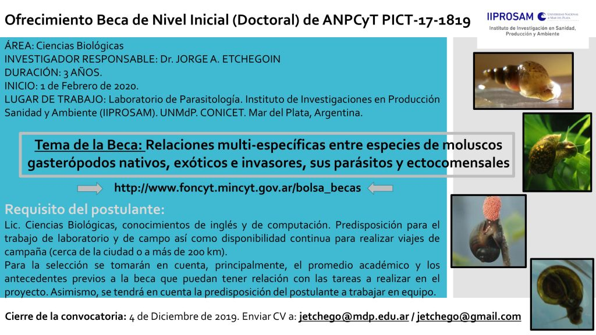

El Laboratorio de Parasitología del **Instituto de Investigaciones en Producción, Sanidad y Ambiente (IIPROSAM, UNMdP-CONICET)** ofrece una **beca de nivel inicial (doctoral) de la ANPCyT**, en el marco del proyecto PICT-17-1819.

El tema de investigación son las **relaciones multiespecíficas entre moluscos gasterópodos nativos, exóticos e invasores, sus parásitos y ectocomensales**. El investigador responsable es el **Dr. Jorge A. Etchegoin**.

## Detalles de la beca

- **Área:** Ciencias Biológicas.
- **Duración:** 3 años, desde el 1 de febrero de 2020.
- **Lugar de trabajo:** Laboratorio de Parasitología del IIPROSAM, Mar del Plata.
- **Perfil buscado:** licenciatura en Ciencias Biológicas, conocimientos de inglés y computación, predisposición para el trabajo de laboratorio y de campo, y disponibilidad para viajes de campaña (cerca de la ciudad o a más de 200 km).
- **Selección:** se tendrán en cuenta principalmente el promedio académico, los antecedentes vinculados al proyecto y la predisposición para trabajar en equipo.

**Cierre de la convocatoria: 4 de diciembre de 2019.** Los CV deben enviarse a jetchego@mdp.edu.ar o jetchego@gmail.com. Más información en la [bolsa de becas del FONCyT](http://www.foncyt.mincyt.gov.ar/bolsa_becas).
