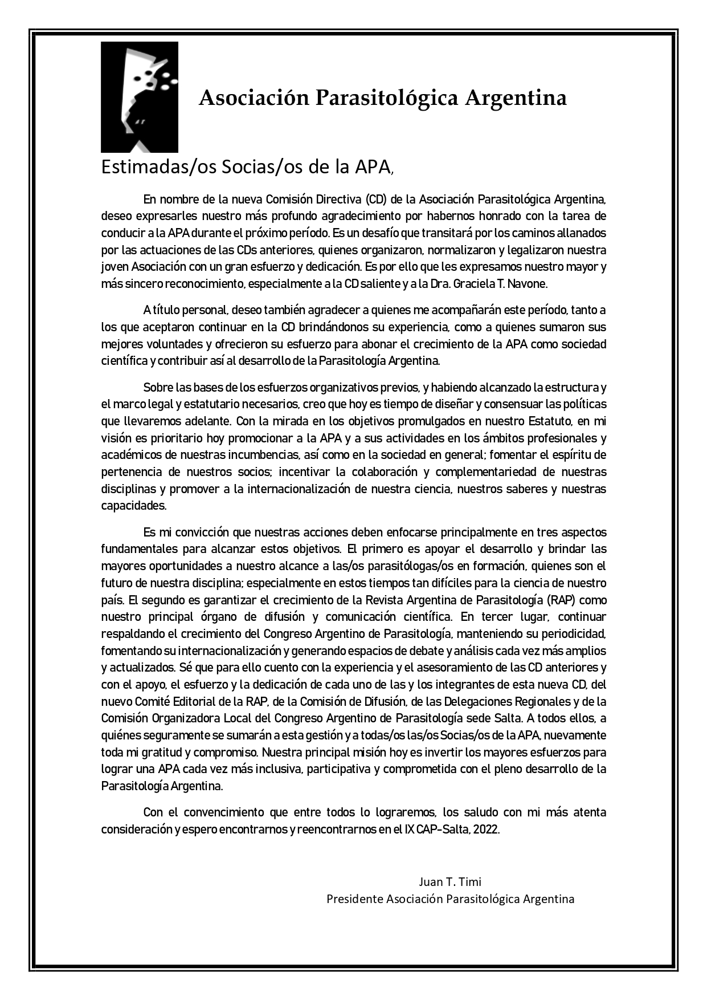

Con el inicio de la nueva gestión, el presidente de la Asociación Parasitológica Argentina, **Dr. Juan T. Timi**, envió una carta a todas las socias y todos los socios. En ella agradece la confianza depositada en la nueva Comisión Directiva y reconoce el trabajo de las gestiones anteriores, que organizaron, normalizaron y dieron marco legal a la Asociación, con un agradecimiento especial a la **Dra. Graciela T. Navone** y a la Comisión Directiva saliente.

Con la estructura institucional ya consolidada, Timi plantea que llegó el momento de diseñar y consensuar las políticas de la APA: promocionarla en los ámbitos académicos y profesionales y en la sociedad en general, fortalecer el sentido de pertenencia, impulsar la colaboración entre disciplinas e internacionalizar la parasitología argentina.

## Tres ejes de trabajo

1. **Las y los parasitólogos en formación**, futuro de la disciplina, a quienes la APA buscará brindar las mayores oportunidades posibles, «especialmente en estos tiempos tan difíciles para la ciencia de nuestro país».
2. **La Revista Argentina de Parasitología**, principal órgano de difusión científica de la Asociación.
3. **El Congreso Argentino de Parasitología**, sosteniendo su periodicidad, su internacionalización y espacios de debate cada vez más amplios.

La carta cierra con una invitación a construir una APA «cada vez más inclusiva, participativa y comprometida» y con una cita para todos: el **IX Congreso Argentino de Parasitología, Salta 2022**.

[Leé la carta completa aquí](/assets/docs/carta-presidente-2019.pdf)
