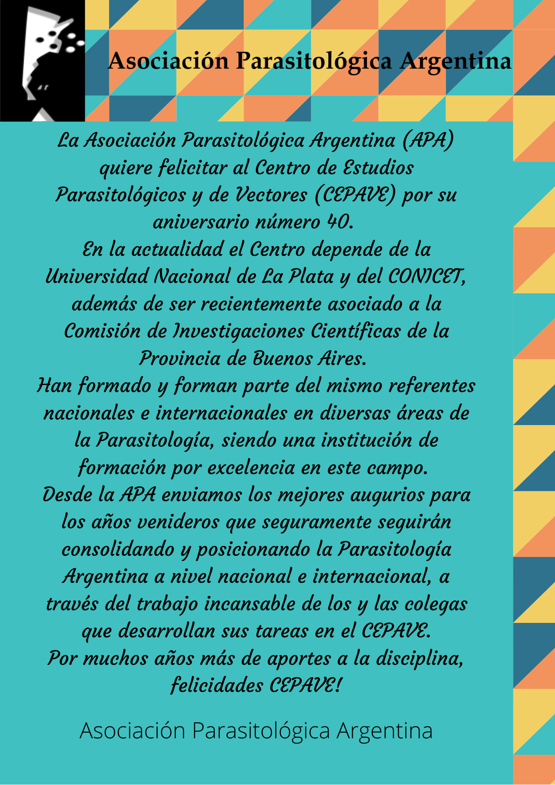

La Asociación Parasitológica Argentina felicita al **Centro de Estudios Parasitológicos y de Vectores (CEPAVE)** por sus **40 años**.

El CEPAVE depende de la Universidad Nacional de La Plata y del CONICET, y recientemente se asoció también a la Comisión de Investigaciones Científicas de la Provincia de Buenos Aires. Por sus laboratorios pasaron, y siguen trabajando, referentes nacionales e internacionales de diversas áreas de la parasitología, lo que lo convierte en una institución de formación por excelencia en este campo.

Desde la APA enviamos los mejores augurios para los años que vienen, que seguramente seguirán consolidando a la parasitología argentina a nivel nacional e internacional gracias al trabajo incansable de las y los colegas del CEPAVE.

¡Por muchos años más de aportes a la disciplina, felicidades CEPAVE!
