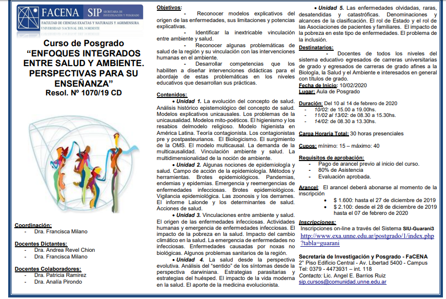

La Facultad de Ciencias Exactas y Naturales y Agrimensura de la **Universidad Nacional del Nordeste (FaCENA-UNNE)** dictará del **10 al 14 de febrero de 2020** el curso de posgrado **«Enfoques integrados entre salud y ambiente. Perspectivas para su enseñanza»** (Resol. N.º 1070/19 CD). La propuesta cuenta con el **aval de la Comisión Directiva de la APA**.

El curso invita a reconocer los modelos que explican el origen de las enfermedades, entender el vínculo inseparable entre ambiente y salud, analizar las problemáticas sanitarias de la región y desarrollar herramientas para diseñar intervenciones didácticas en los distintos niveles educativos.

## Contenidos

1. **La evolución del concepto de salud:** de los modelos unicausales al modelo multicausal y el surgimiento de la OMS.
2. **Nociones de epidemiología:** brotes, pandemias, endemias y epidemias, enfermedades emergentes y reemergentes, zoonosis y determinantes de la salud.
3. **Vínculos entre ambiente y salud:** actividades humanas, pobreza y cambio climático como factores de enfermedad.
4. **La salud desde la perspectiva evolutiva:** estrategias parasitarias y del huésped, y el aporte de la medicina evolucionista.
5. **Enfermedades olvidadas, raras, desatendidas y catastróficas:** el rol del Estado y de las asociaciones de pacientes.

## Datos del curso

- **Coordinación:** Dra. Francisca Milano.
- **Docentes:** Dra. Andrea Revel Chion y Dra. Francisca Milano. Colaboran la Dra. Patricia Ramírez y la Dra. Analía Pirondo.
- **Destinatarios:** docentes de todos los niveles con título universitario de grado y egresados de carreras afines a la biología, la salud y el ambiente.
- **Carga horaria:** 30 horas presenciales. Cupo de 15 a 40 personas.
- **Arancel:** $1.600 hasta el 27 de diciembre de 2019; $2.100 desde el 28 de diciembre hasta el 7 de febrero de 2020.
- **Contacto:** Secretaría de Investigación y Posgrado de FaCENA, tel. 0379-4473931 int. 118, sip.cursos@comunidad.unne.edu.ar

La inscripción es en línea a través del [sistema SIU-Guaraní de la UNNE](http://www.exa.unne.edu.ar/postgrado/1/index.php?tabla=guarani).
