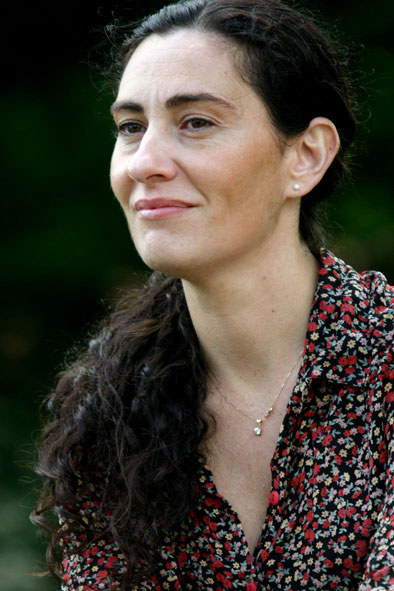

El 14 de enero de 2020 falleció en Buenos Aires la **Dra. Verónica A. Ivanov** (1967-2020), luego de luchar contra una larga enfermedad. Su partida es una gran pérdida para la ciencia argentina.

Verónica formó parte del grupo de jóvenes investigadores que dio un nuevo impulso a la parasitología de organismos acuáticos en el país. Se recibió de licenciada en Biología en la Universidad Nacional de La Plata en 1991 y en 1992 ingresó como becaria del CONICET al laboratorio de Helmintos del CEPAVE, donde hizo su tesis doctoral sobre la ecología de helmintos de peces elasmobranquios, defendida en 1996.

Después se perfeccionó en Estados Unidos en el estudio de los cestodes de peces junto al Dr. Ronald Campbell. A su regreso, en 1999, ingresó a la Carrera del Investigador del CONICET en el Laboratorio de Helmintos de la UBA. Desde allí se convirtió en **referente nacional e internacional en cestodes de ambientes acuáticos**, con aportes clave sobre la diversidad y la ecología de tetrafilídeos y tripanorrincos en Argentina.

Dirigió becarios, tesis de licenciatura y de doctorado y equipos de investigación, y fue miembro fundador y codirectora del IBBEA (CONICET-UBA). Como docente llegó a ser profesora adjunta de Invertebrados I en la FCEyN-UBA.

Hasta sus últimos días, con la entereza y la tenacidad que la caracterizaban, siguió guiando al grupo de Sistemática y Biología de Parásitos de Organismos Acuáticos, e incluso preparó un curso de posgrado sobre cestodes que su salud ya no le permitió dictar. Su legado sigue vivo en sus discípulos y en una obra científica que acompañará a las próximas generaciones de parasitólogos.

> «Nos quedan las mateadas en el CEPAVE, nuestras largas cenas y divertidas charlas en Buenos Aires y Mar del Plata y el humor siempre ocurrente de Vero resonando en nuestro recuerdo. Te vamos a extrañar mucho pero nunca te olvidaremos. Descansa en paz, Vero querida.»
>
> — Graciela T. Navone (CEPAVE) y Jorge A. Etchegoin (IIPROSAM)
