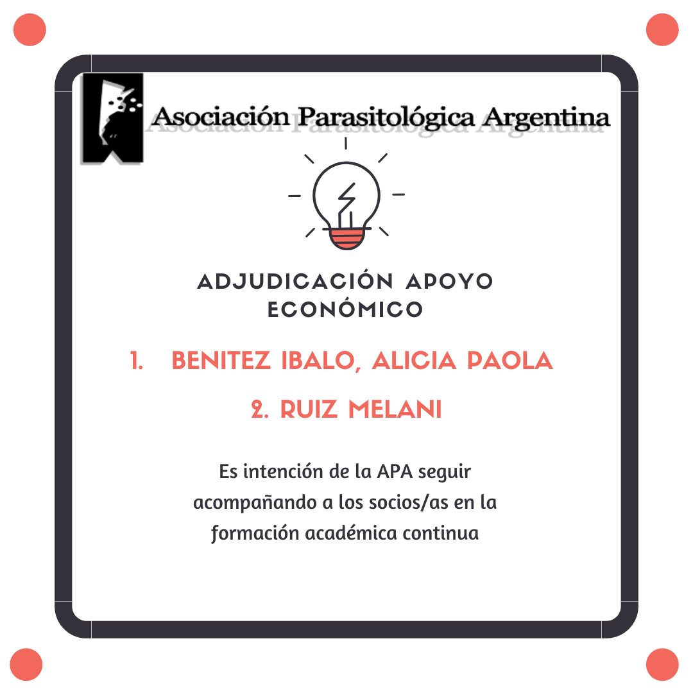

La Comisión Directiva de la **Asociación Parasitológica Argentina** anunció el orden de mérito de la convocatoria de marzo de 2020 de **apoyo económico para socias y socios que deseen realizar cursos o capacitaciones**:

1. **Alicia Paola Benítez Ibalo**
2. **Melani Ruiz**

¡Felicitaciones a Paola y a Melani!

La APA sigue apostando a la formación académica continua de sus socias y socios. **La próxima convocatoria se realizará entre el 1 y el 10 de junio de 2020.**

Un agradecimiento especial a las delegadas y los delegados regionales, que evaluaron todas las solicitudes.
