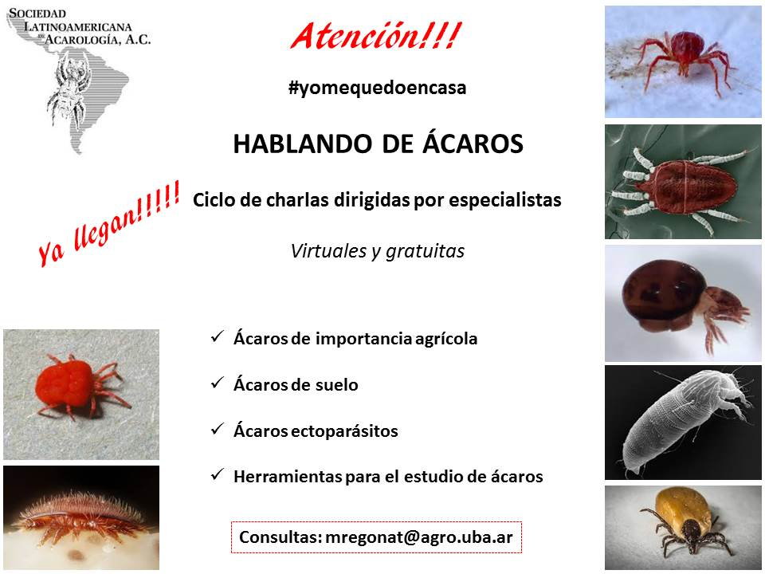

En plena cuarentena y bajo el lema #yomequedoencasa, la **Sociedad Latinoamericana de Acarología** organiza **«Hablando de ácaros»**, un ciclo de **charlas virtuales y gratuitas** a cargo de especialistas.

## Temas del ciclo

- Ácaros de importancia agrícola
- Ácaros de suelo
- Ácaros ectoparásitos
- Herramientas para el estudio de ácaros

**Consultas:** mregonat@agro.uba.ar
