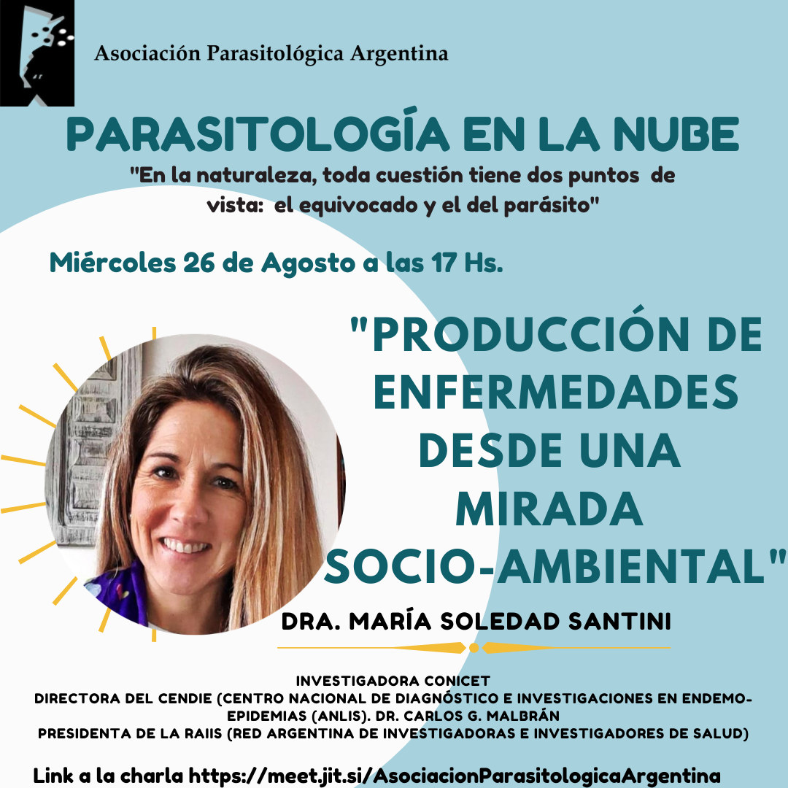

El ciclo **Parasitología en la Nube** de la APA continúa el **miércoles 26 de agosto a las 17 h** con la charla **«Producción de enfermedades desde una mirada socioambiental»**.

La expositora será la **Dra. María Soledad Santini**, investigadora del CONICET, directora del Centro Nacional de Diagnóstico e Investigación en Endemo-Epidemias (CeNDIE, ANLIS «Dr. Carlos G. Malbrán») y presidenta de la Red Argentina de Investigadoras e Investigadores de Salud (RAIIS).

La actividad es abierta y se realiza en línea. [Ingresá a la charla aquí](https://meet.jit.si/AsociacionParasitologicaArgentina)
