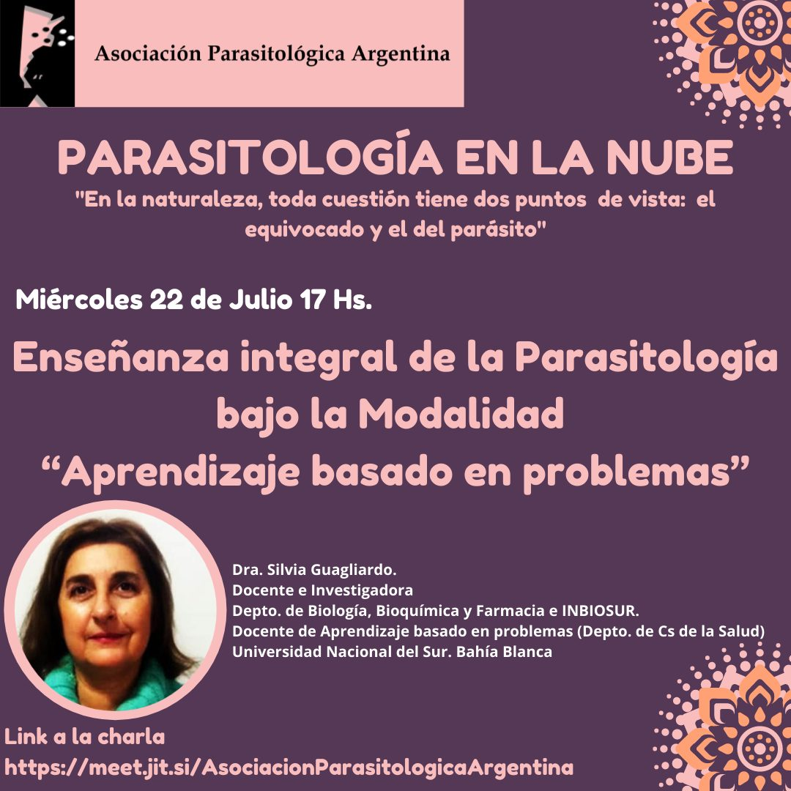

El ciclo **Parasitología en la Nube** de la APA continúa el **miércoles 22 de julio a las 17 h** con la charla **«Enseñanza integral de la Parasitología bajo la Modalidad “Aprendizaje basado en problemas”»**.

La expositora será la **Dra. Silvia Guagliardo**, docente e investigadora del Departamento de Biología, Bioquímica y Farmacia y del INBIOSUR, y docente de Aprendizaje Basado en Problemas en el Departamento de Ciencias de la Salud de la Universidad Nacional del Sur (Bahía Blanca).

La Dra. Guagliardo compartió bibliografía recomendada, disponible en [esta carpeta](https://drive.google.com/drive/folders/1zNVrx91PRNLOr2G2mlNJgYCVjm52TRGT?usp=sharing).

Podés ver la charla aquí:


