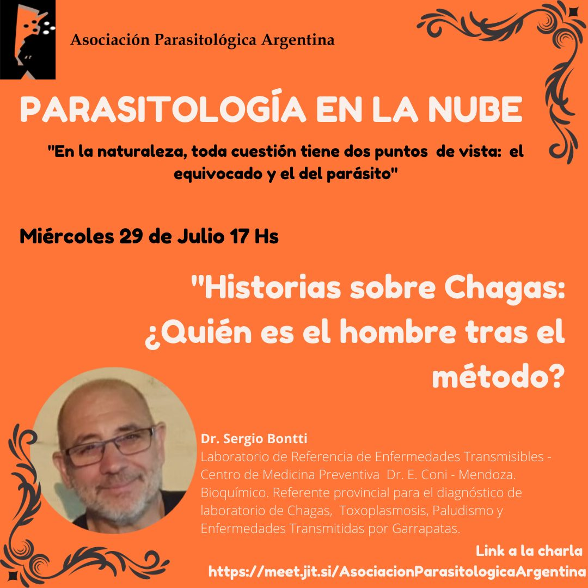

El ciclo **Parasitología en la Nube** de la APA continúa el **miércoles 29 de julio a las 17 h** con la charla **«Historias sobre Chagas: ¿Quién es el hombre tras el método?»**.

El expositor será el **Dr. Sergio Bontti**, bioquímico del Laboratorio de Referencia de Enfermedades Transmisibles del Centro de Medicina Preventiva «Dr. E. Coni» (Mendoza) y referente provincial para el diagnóstico de laboratorio de Chagas, toxoplasmosis, paludismo y enfermedades transmitidas por garrapatas.

Podés ver la charla aquí:


