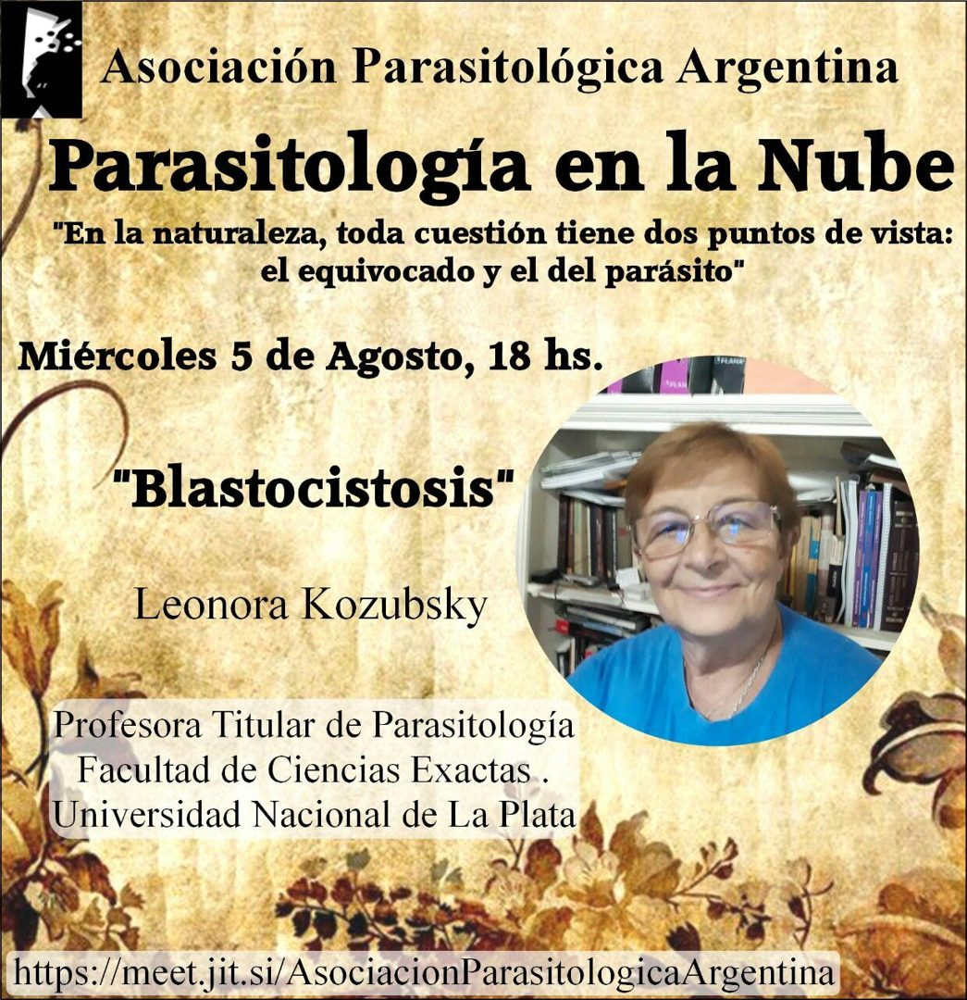

El ciclo **Parasitología en la Nube** de la APA continúa el **miércoles 5 de agosto a las 18 h** con la charla **«Blastocistosis»**.

La expositora será la **Dra. Leonora Kozubsky**, profesora titular de Parasitología de la Facultad de Ciencias Exactas de la Universidad Nacional de La Plata.

Podés ver la charla aquí:


