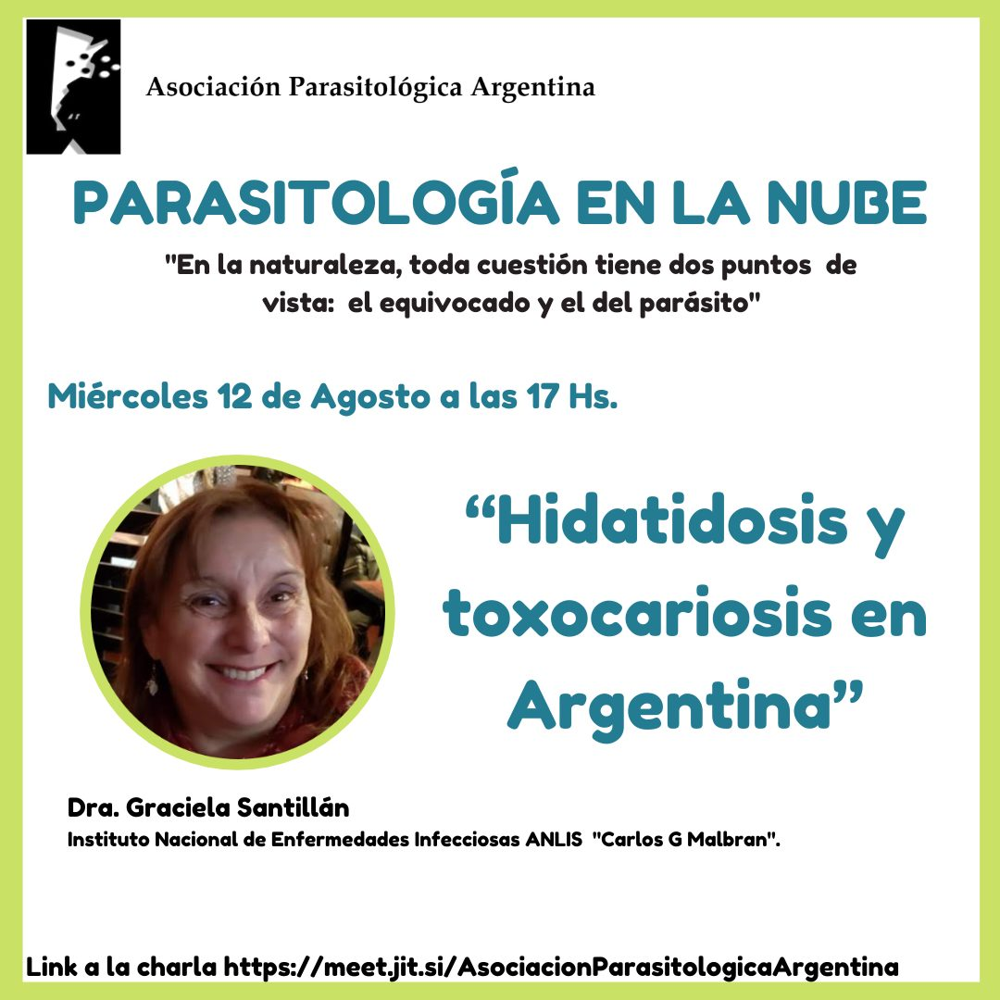

El ciclo **Parasitología en la Nube** de la APA continúa el **miércoles 12 de agosto a las 17 h** con la charla **«Hidatidosis y Toxocariosis en Argentina»**.

La expositora será la **Dra. Graciela Santillán**, del Instituto Nacional de Enfermedades Infecciosas, ANLIS «Dr. Carlos G. Malbrán».

Podés ver la charla aquí:


