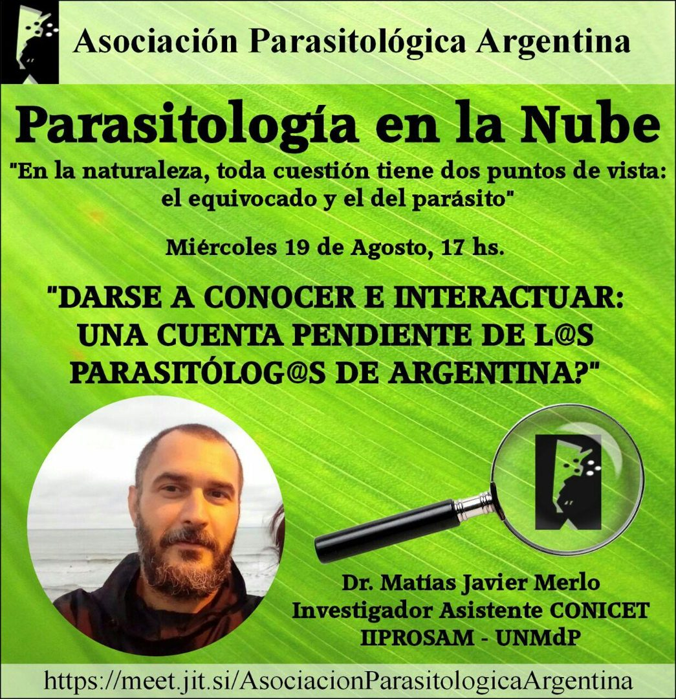

El ciclo **Parasitología en la Nube** de la APA continúa el **miércoles 19 de agosto a las 17 h** con la charla **«¿Darse a conocer e interactuar: una cuenta pendiente de l@s parasitólog@s de Argentina?»**.

El expositor será el **Dr. Matías Javier Merlo**, investigador asistente del CONICET en el IIPROSAM (UNMdP).

Podés ver la charla aquí:


