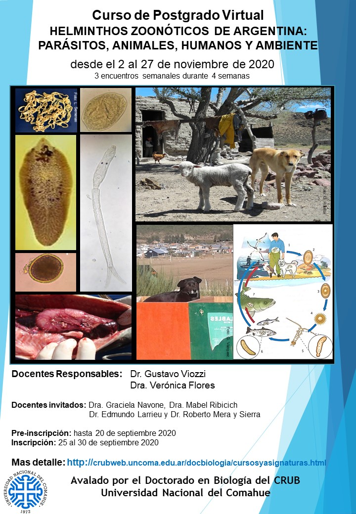

El Centro Regional Universitario Bariloche (CRUB) de la **Universidad Nacional del Comahue** dictará el curso de posgrado virtual **«Helmintos zoonóticos de Argentina: parásitos, animales, humanos y ambiente»**, del **2 al 27 de noviembre de 2020**, con tres encuentros semanales durante cuatro semanas.

El curso está avalado por el Doctorado en Biología del CRUB y reúne a especialistas de referencia en zoonosis parasitarias.

## Docentes

- **Responsables:** Dr. Gustavo Viozzi y Dra. Verónica Flores.
- **Invitados:** Dra. Graciela Navone, Dra. Mabel Ribicich, Dr. Edmundo Larrieu y Dr. Roberto Mera y Sierra.

## Fechas clave

- **Preinscripción:** hasta el 20 de septiembre de 2020.
- **Inscripción:** del 25 al 30 de septiembre de 2020.

[Más información sobre el curso aquí](http://crubweb.uncoma.edu.ar/docbiologia/cursosyasignaturas.html)
