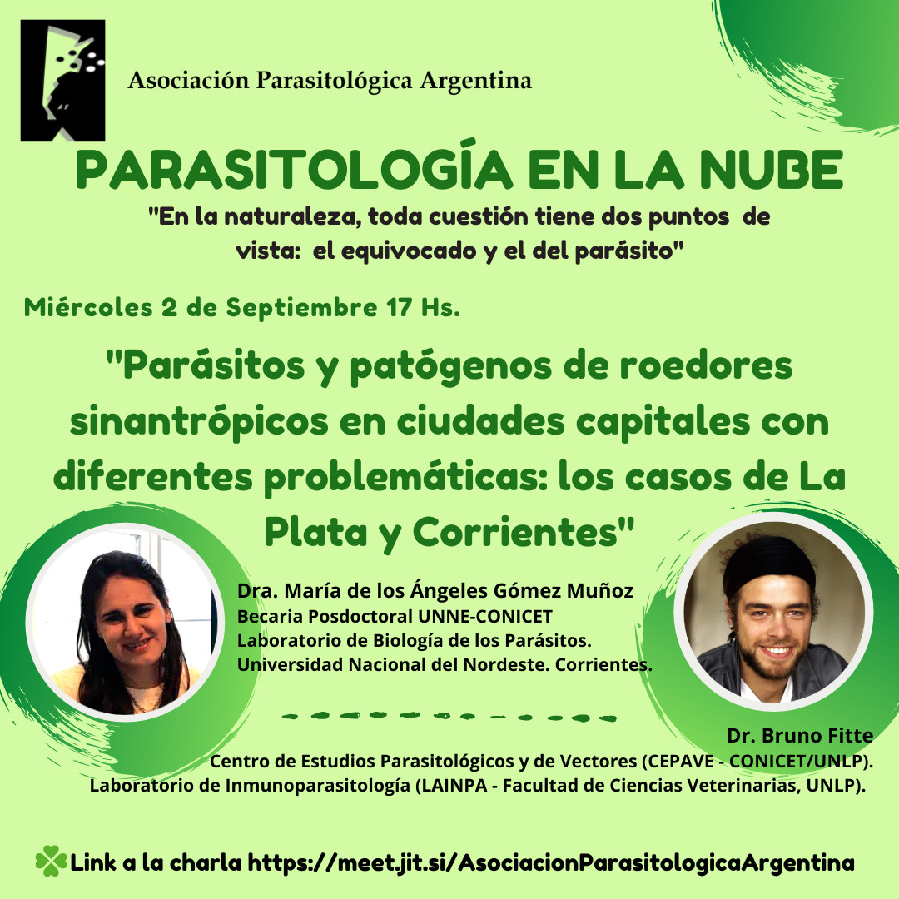

El ciclo **Parasitología en la Nube** presenta el **miércoles 2 de septiembre a las 17 h** la charla **«Parásitos y patógenos de roedores sinantrópicos en ciudades capitales con diferentes problemáticas: los casos de La Plata y Corrientes»**.

## Expositores

- **Dra. María de los Ángeles Gómez Muñoz**, becaria posdoctoral UNNE-CONICET, Laboratorio de Biología de los Parásitos, Universidad Nacional del Nordeste (Corrientes).
- **Dr. Bruno Fitte**, Centro de Estudios Parasitológicos y de Vectores (CEPAVE, CONICET-UNLP) y Laboratorio de Inmunoparasitología (LAINPA, Facultad de Ciencias Veterinarias, UNLP).

La actividad es abierta y en línea. [Ingresá a la charla aquí](https://meet.jit.si/AsociacionParasitologicaArgentina)
