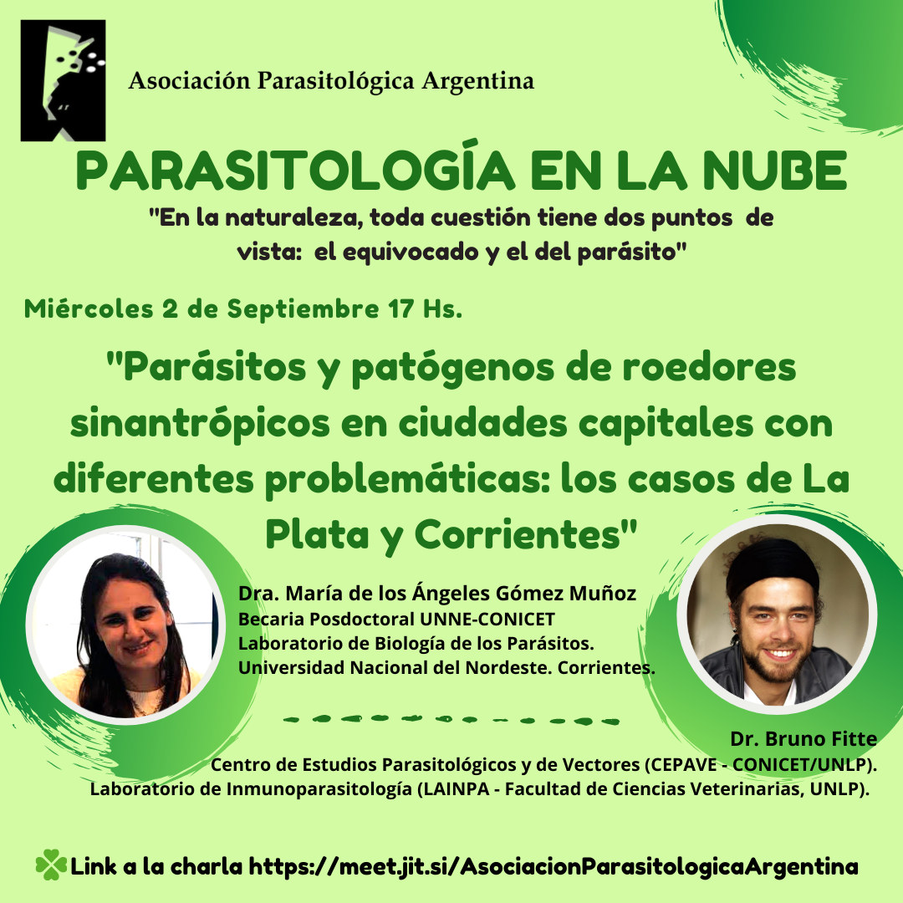

El ciclo **Parasitología en la Nube** de la APA continúa el **miércoles 2 de septiembre a las 17 h** con la charla **«Parásitos y patógenos de roedores sinantrópicos en ciudades capitales con diferentes problemáticas: los casos de La Plata y Corrientes»**.

Los expositores serán la **Dra. María de los Ángeles Gómez Muñoz**, becaria posdoctoral UNNE-CONICET en el Laboratorio de Biología de los Parásitos de la Universidad Nacional del Nordeste (Corrientes), y el **Dr. Bruno Fitte**, del Centro de Estudios Parasitológicos y de Vectores (CEPAVE, CONICET-UNLP) y del Laboratorio de Inmunoparasitología (LAINPA, Facultad de Ciencias Veterinarias, UNLP).

Podés ver la charla aquí:


