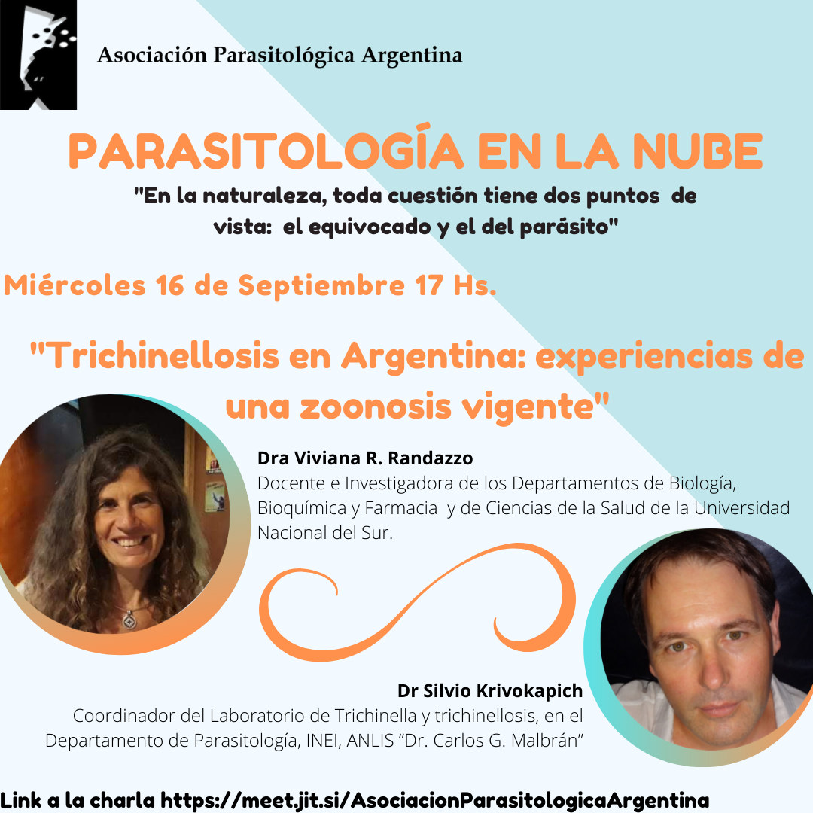

El **miércoles 16 de septiembre a las 17 h**, el ciclo **Parasitología en la Nube** presenta la charla **«Trichinellosis en Argentina: experiencias de una zoonosis vigente»**.

## Expositores

- **Dra. Viviana R. Randazzo**, docente e investigadora de los departamentos de Biología, Bioquímica y Farmacia y de Ciencias de la Salud de la Universidad Nacional del Sur.
- **Dr. Silvio Krivokapich**, coordinador del Laboratorio de *Trichinella* y Trichinellosis del Departamento de Parasitología del INEI-ANLIS «Dr. Carlos G. Malbrán».

La actividad es abierta y en línea. [Ingresá a la charla aquí](https://meet.jit.si/AsociacionParasitologicaArgentina)
