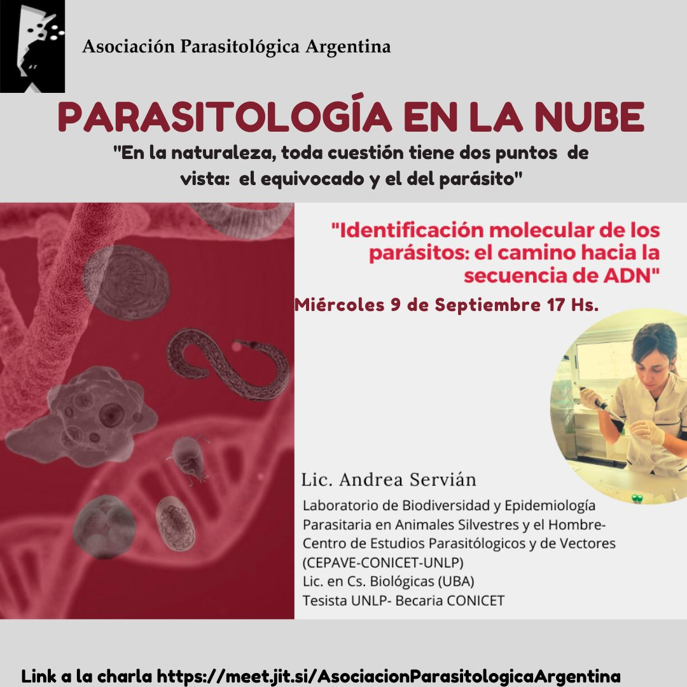

El ciclo **Parasitología en la Nube** de la APA continúa el **miércoles 9 de septiembre a las 17 h** con la charla **«Identificación molecular de los parásitos: el camino hacia la secuencia de ADN»**.

La expositora será la **Lic. Andrea Servián**, licenciada en Ciencias Biológicas (UBA), tesista de la UNLP y becaria del CONICET en el Laboratorio de Biodiversidad y Epidemiología Parasitaria en Animales Silvestres y el Hombre del Centro de Estudios Parasitológicos y de Vectores (CEPAVE, CONICET-UNLP).

La Lic. Servián compartió su [presentación en PDF](/assets/docs/presentacion-servian-2020.pdf). También dejamos un [libro sobre detección molecular de parásitos humanos](https://drive.google.com/file/d/1w_E_74LbT9sur34TeRzMejUlZJzplVi5/view?usp=sharing).

Podés ver la charla aquí:

Parte uno:



Parte dos:


