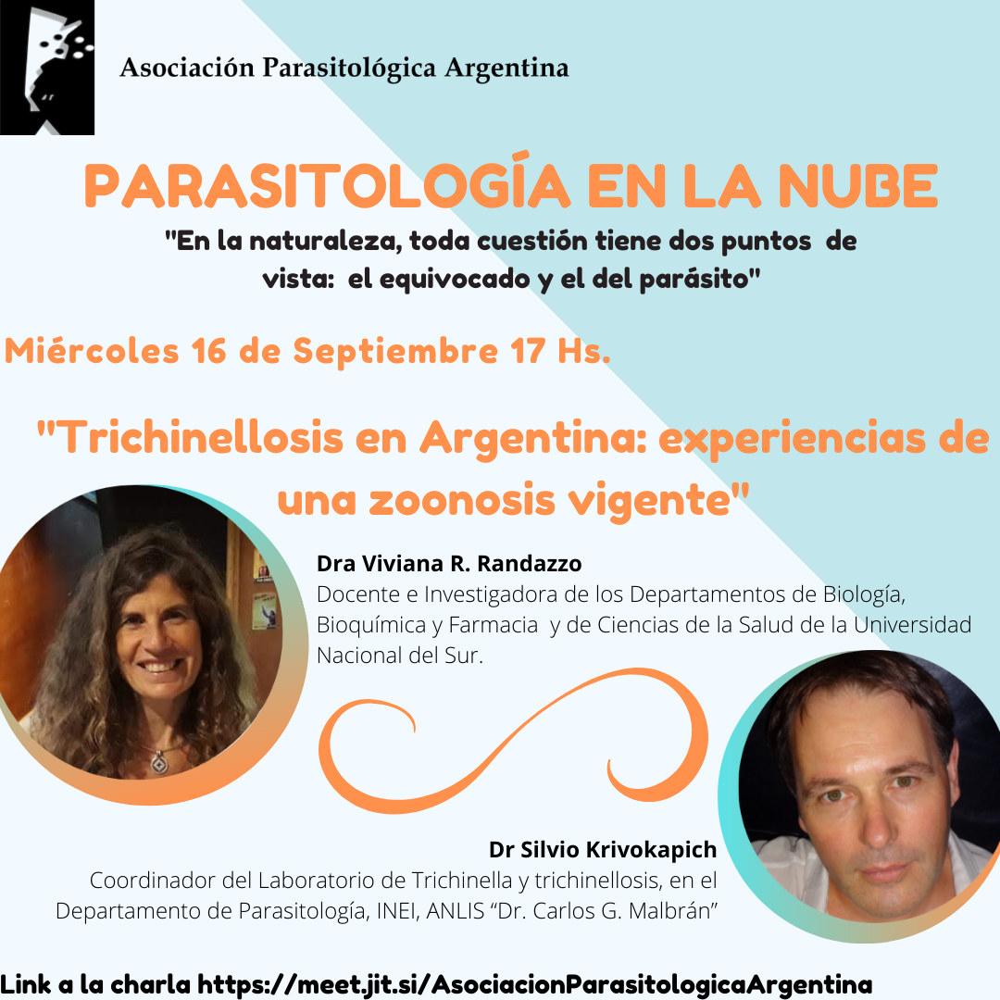

El ciclo **Parasitología en la Nube** de la APA continúa el **miércoles 16 de septiembre a las 17 h** con la charla **«Trichinellosis en Argentina: experiencias de una zoonosis vigente»**.

Los expositores serán la **Dra. Viviana R. Randazzo**, docente e investigadora de los departamentos de Biología, Bioquímica y Farmacia y de Ciencias de la Salud de la Universidad Nacional del Sur, y el **Dr. Silvio Krivokapich**, coordinador del Laboratorio de *Trichinella* y Trichinellosis del Departamento de Parasitología del INEI-ANLIS «Dr. Carlos G. Malbrán».

Podés ver la charla aquí:


