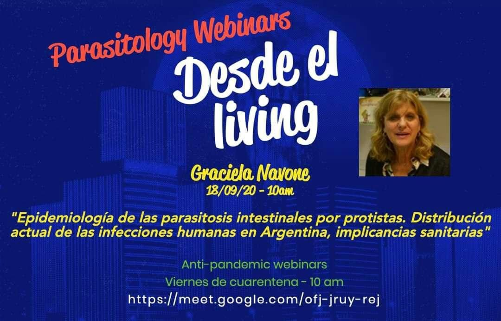

La **Dra. Graciela Navone** será la invitada del ciclo **«Parasitology Webinars: desde el living»**, organizado por la Sociedad Argentina de Protozoología, el **viernes 18 de septiembre de 2020 a las 10 h**.

Su charla se titula **«Epidemiología de las parasitosis intestinales por protistas. Distribución actual de las infecciones humanas en Argentina, implicancias sanitarias»**.

La charla se transmite por Google Meet. [Ingresá al webinar aquí](https://meet.google.com/ofj-jruy-rej)
