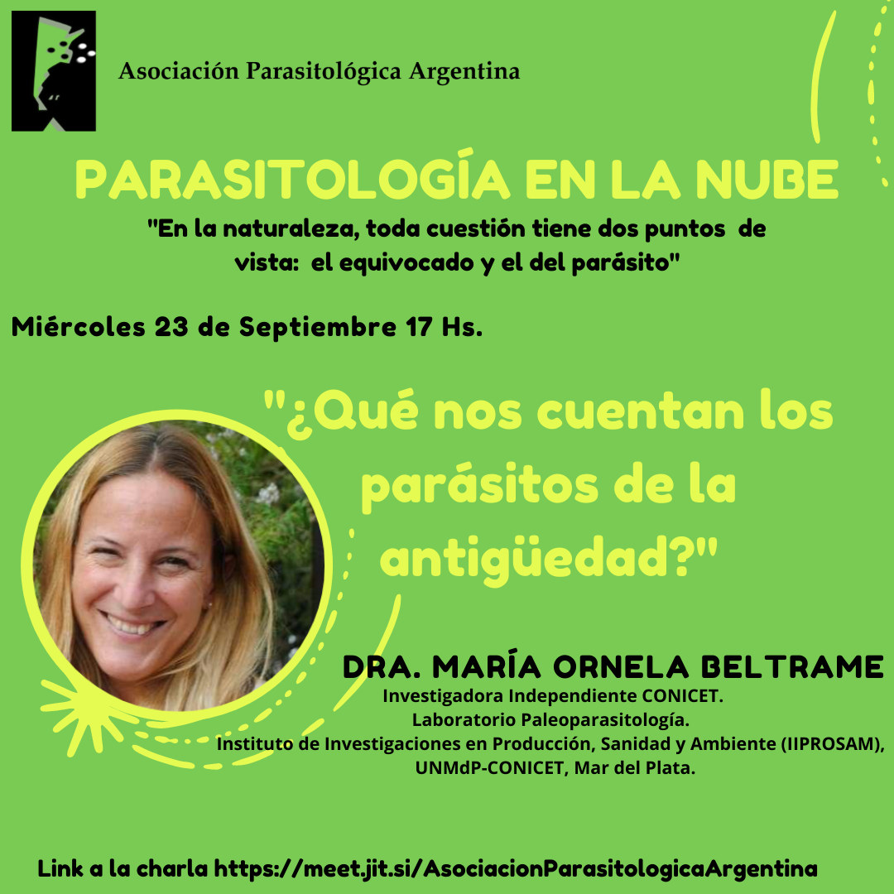

Los parásitos también dejan rastros en el pasado, y estudiarlos permite reconstruir cómo vivían las personas y los animales hace cientos o miles de años. De eso tratará la próxima charla del ciclo **Parasitología en la Nube**: **«¿Qué nos cuentan los parásitos de la antigüedad?»**, el **miércoles 23 de septiembre a las 17 h**.

La expositora será la **Dra. María Ornela Beltrame**, investigadora independiente del CONICET en el Laboratorio de Paleoparasitología del Instituto de Investigaciones en Producción, Sanidad y Ambiente (IIPROSAM, UNMdP-CONICET), en Mar del Plata.

La actividad es abierta y en línea. [Ingresá a la charla aquí](https://meet.jit.si/AsociacionParasitologicaArgentina)
