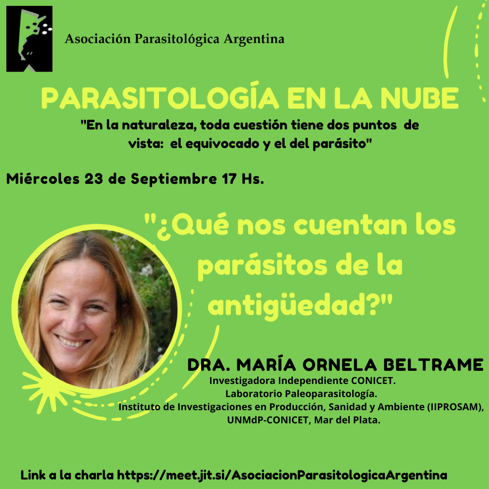

El ciclo **Parasitología en la Nube** de la APA continúa el **miércoles 23 de septiembre a las 17 h** con la charla **«¿Qué nos cuentan los parásitos en la antigüedad?»**.

La expositora será la **Dra. María Ornela Beltrame**, investigadora independiente del CONICET en el Laboratorio de Paleoparasitología del Instituto de Investigaciones en Producción, Sanidad y Ambiente (IIPROSAM, UNMdP-CONICET), en Mar del Plata.

Podés ver la charla aquí:


