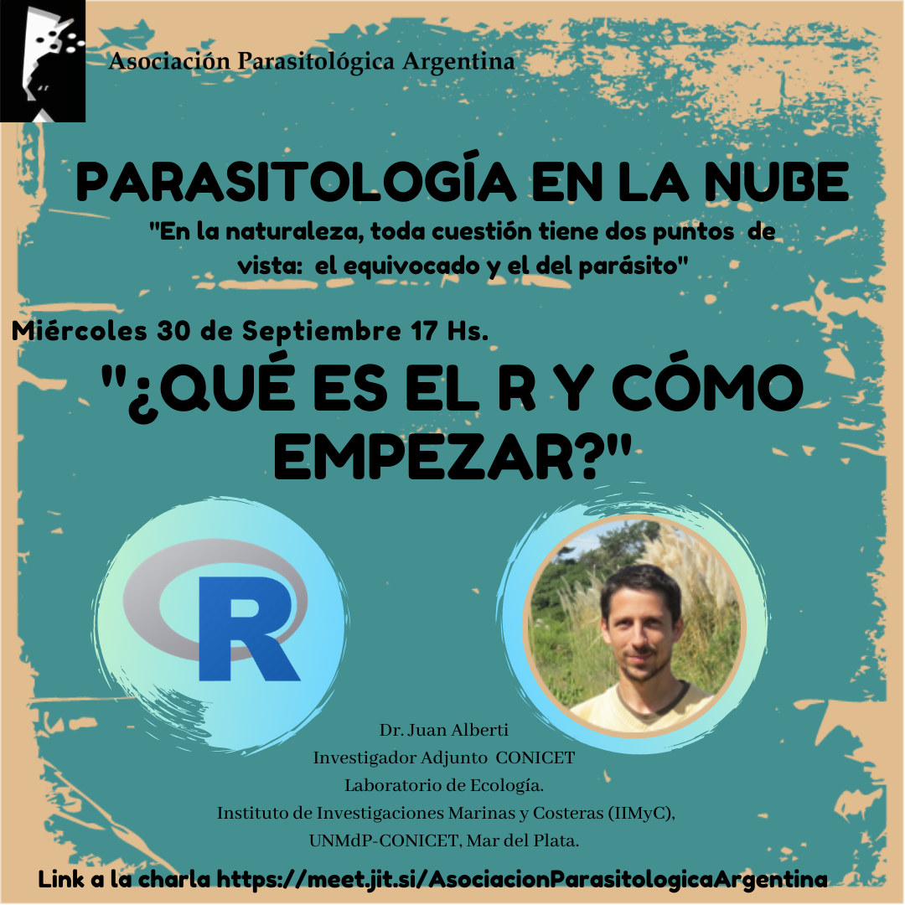

R se convirtió en una herramienta indispensable para analizar datos en biología, ecología y parasitología. Para quienes todavía no se animaron a usarlo, el ciclo **Parasitología en la Nube** propone la charla **«¿Qué es el R y cómo empezar?»**, el **miércoles 30 de septiembre a las 17 h**.

El expositor será el **Dr. Juan Alberti**, investigador adjunto del CONICET en el Laboratorio de Ecología del Instituto de Investigaciones Marinas y Costeras (IIMyC, UNMdP-CONICET), en Mar del Plata.

La actividad es abierta y en línea. [Ingresá a la charla aquí](https://meet.jit.si/AsociacionParasitologicaArgentina)
