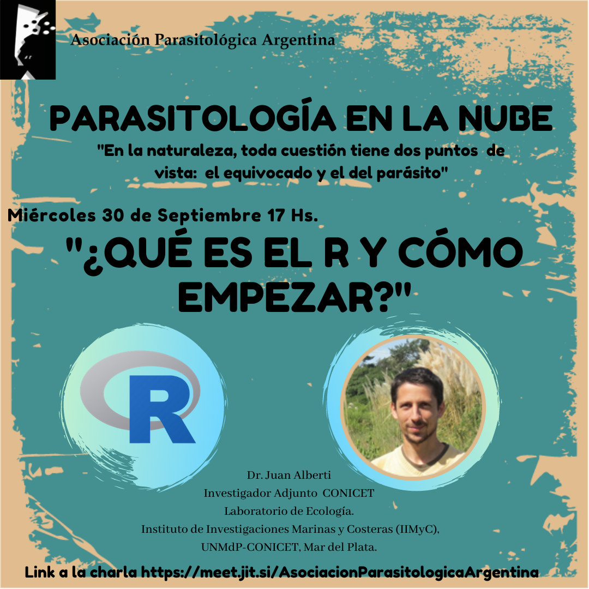

El ciclo **Parasitología en la Nube** de la APA continúa el **miércoles 30 de septiembre a las 17 h** con la charla **«¿Qué es el R y cómo empezar?»**.

El expositor será el **Dr. Juan Alberti**, investigador adjunto del CONICET en el Laboratorio de Ecología del Instituto de Investigaciones Marinas y Costeras (IIMyC, UNMdP-CONICET), en Mar del Plata.

Podés ver la charla aquí:


