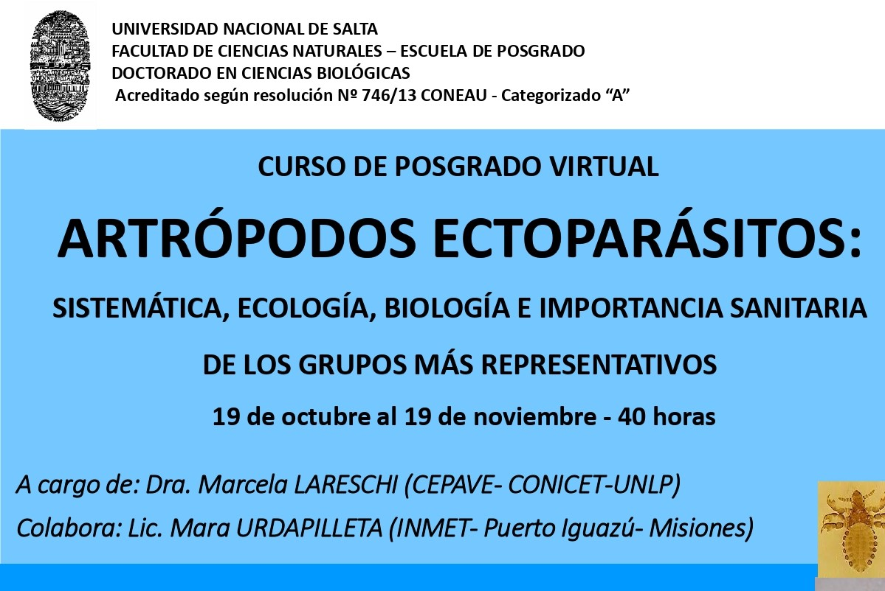
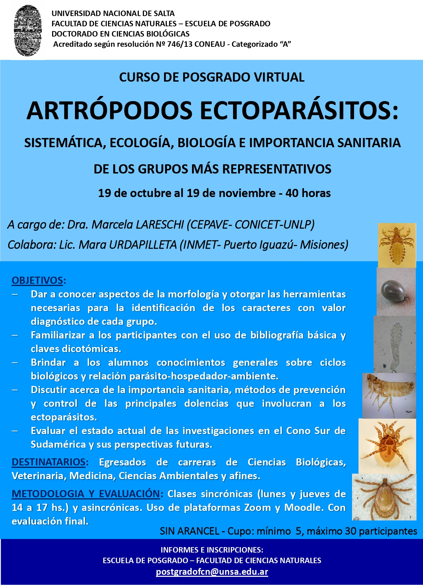

La Escuela de Posgrado de la Facultad de Ciencias Naturales de la **Universidad Nacional de Salta** dictará en **modalidad virtual y sin arancel** el curso **«Artrópodos ectoparásitos: sistemática, ecología, biología e importancia sanitaria de los grupos más representativos»**, del **19 de octubre al 19 de noviembre de 2020**.

El curso forma parte de la oferta del Doctorado en Ciencias Biológicas de la UNSa y estará a cargo de la **Dra. Marcela Lareschi** (CEPAVE, CONICET-UNLP), con la colaboración de la **Lic. Mara Urdapilleta** (INMeT, Puerto Iguazú, Misiones).

## Objetivos

- Conocer la morfología de cada grupo y los caracteres con valor diagnóstico para su identificación.
- Familiarizarse con la bibliografía básica y el uso de claves dicotómicas.
- Comprender los ciclos biológicos y la relación entre parásito, hospedador y ambiente.
- Discutir la importancia sanitaria y los métodos de prevención y control de las principales enfermedades asociadas.
- Repasar el estado actual de las investigaciones en el Cono Sur y sus perspectivas.

## Modalidad

- **Carga horaria:** 40 horas.
- **Clases sincrónicas** los lunes y jueves de 14 a 17 h por Zoom, más actividades asincrónicas en Moodle, con evaluación final.
- **Dirigido a:** egresados de Ciencias Biológicas, Veterinaria, Medicina, Ciencias Ambientales y carreras afines.
- **Cupo:** mínimo 5 y máximo 30 participantes.

**Informes e inscripción:** Escuela de Posgrado de la Facultad de Ciencias Naturales, postgradofcn@unsa.edu.ar
