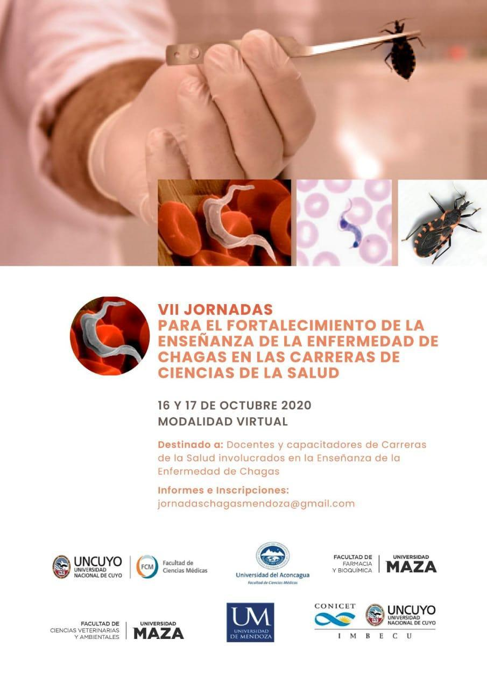

El **16 y 17 de octubre de 2020** se realizarán en modalidad virtual las **VII Jornadas para el fortalecimiento de la enseñanza de la enfermedad de Chagas** en las carreras de Ciencias de la Salud.

Las jornadas están destinadas a docentes y capacitadores de carreras de la salud que enseñan sobre la enfermedad de Chagas. Las organizan facultades de la Universidad Nacional de Cuyo, la Universidad del Aconcagua, la Universidad Juan Agustín Maza, la Universidad de Mendoza y el IMBECU (CCT CONICET Mendoza), con el auspicio de la Asociación Argentina de Zoonosis Filial Cuyo. La presidenta honoraria es la **Dra. Beatriz Basso**.

## Lo más destacado del programa

**Viernes 16 de octubre**

- **Conferencia inaugural:** «Atención médica de Chagas en los sistemas nacionales de salud: abordajes y aproximaciones a la acción», a cargo del Dr. Roberto Chuit (Academia Nacional de Medicina).
- **Talleres simultáneos:** «TIC y enfermedad de Chagas», «Enfermedad de Chagas: una deuda social» (con la Dra. Mariana Sanmartino) y «Competencias, capacidades y enseñanza de Chagas» (con el Dr. Oscar Bottasso).

**Sábado 17 de octubre**

- Conclusiones de los talleres y debate sobre cómo llevar las recomendaciones a la práctica.
- **Conferencia de cierre:** «Cambios en los paradigmas de la enfermedad de Chagas: nuevos escenarios de transmisión en contextos urbanos y rurales», a cargo de la Dra. Paula Sartor (UNNE).

[Programa completo de las jornadas aquí](/assets/docs/programa-jornada-ensenanza-chagas-2020.pdf)

**Inscripción:** a través de [Eventbrite](https://www.eventbrite.com.ar/e/vii-jornadas-de-fortalecimiento-de-la-ensenanza-de-la-enfermedad-de-chagas-tickets-119318499845?ref=estw). **Informes:** jornadaschagasmendoza@gmail.com
