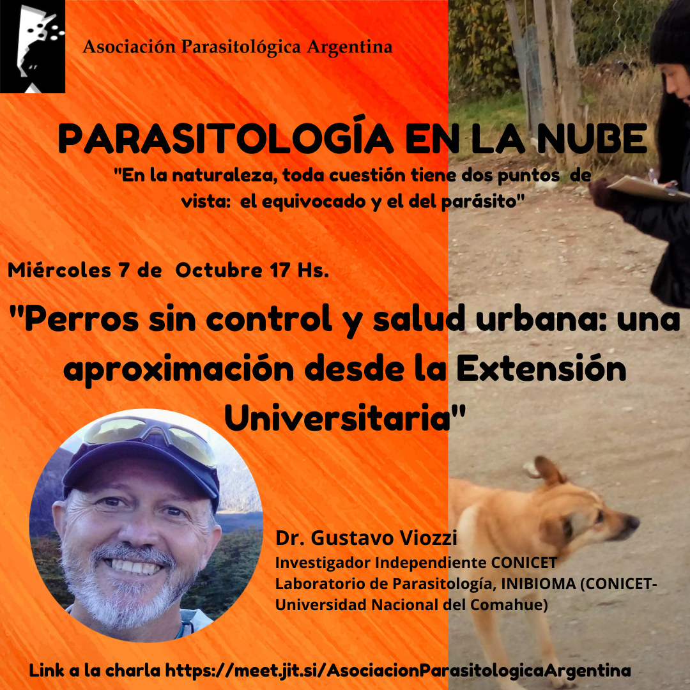

Los perros sin control en las ciudades son un desafío para la salud pública, en especial por las zoonosis parasitarias que pueden transmitir. ¿Qué puede aportar la universidad? De eso hablará el **Dr. Gustavo Viozzi** en la charla **«Perros sin control y salud urbana: una aproximación desde la Extensión Universitaria»**, el **miércoles 7 de octubre a las 17 h**, dentro del ciclo **Parasitología en la Nube**.

Viozzi es investigador independiente del CONICET en el Laboratorio de Parasitología del INIBIOMA (CONICET-Universidad Nacional del Comahue).

La actividad es abierta y en línea. [Ingresá a la charla aquí](https://meet.jit.si/AsociacionParasitologicaArgentina)
