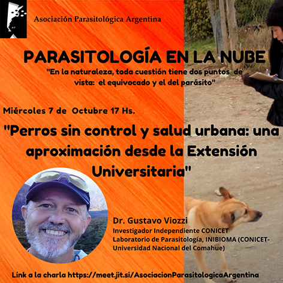

El ciclo **Parasitología en la Nube** de la APA continúa el **miércoles 7 de octubre a las 17 h** con la charla **«Perros sin control y salud urbana: una aproximación desde la Extensión Universitaria»**.

El expositor será el **Dr. Gustavo Viozzi**, investigador independiente del CONICET en el Laboratorio de Parasitología del INIBIOMA (CONICET-Universidad Nacional del Comahue).

Podés ver la charla aquí:


