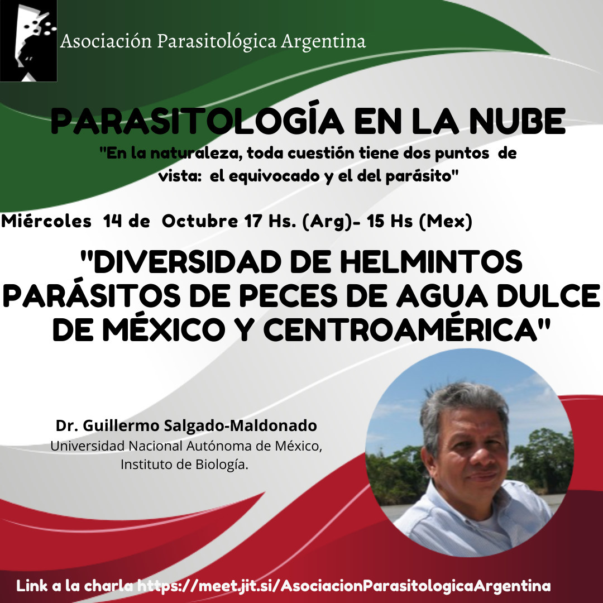

El ciclo **Parasitología en la Nube** suma un invitado internacional: el **Dr. Guillermo Salgado-Maldonado**, del Instituto de Biología de la **Universidad Nacional Autónoma de México (UNAM)**, presentará la charla **«Diversidad de helmintos parásitos de peces de agua dulce de México y Centroamérica»**.

La cita es el **miércoles 14 de octubre a las 17 h de Argentina** (15 h de México).

La actividad es abierta y en línea. [Ingresá a la charla aquí](https://meet.jit.si/AsociacionParasitologicaArgentina)
