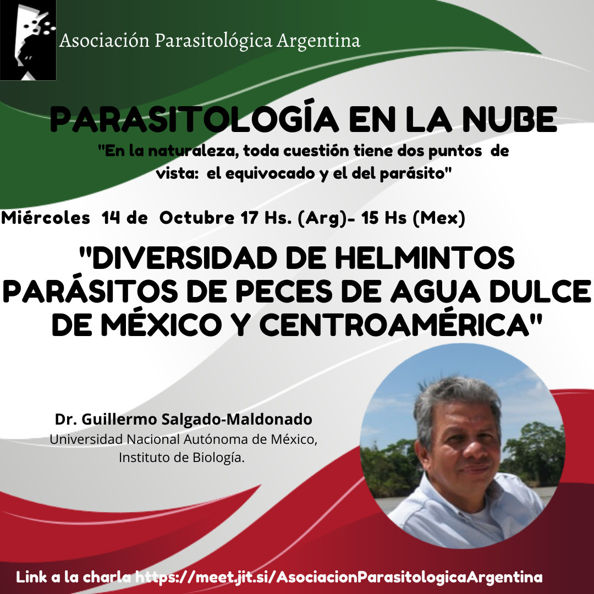

El ciclo **Parasitología en la Nube** de la APA continúa el **miércoles 14 de octubre a las 17 h (15 h de México)** con la charla **«Diversidad de helmintos parásitos de peces de agua dulce de México y Centroamérica»**.

El expositor será el **Dr. Guillermo Salgado-Maldonado**, del Instituto de Biología de la Universidad Nacional Autónoma de México (UNAM).

Podés ver la charla aquí:


