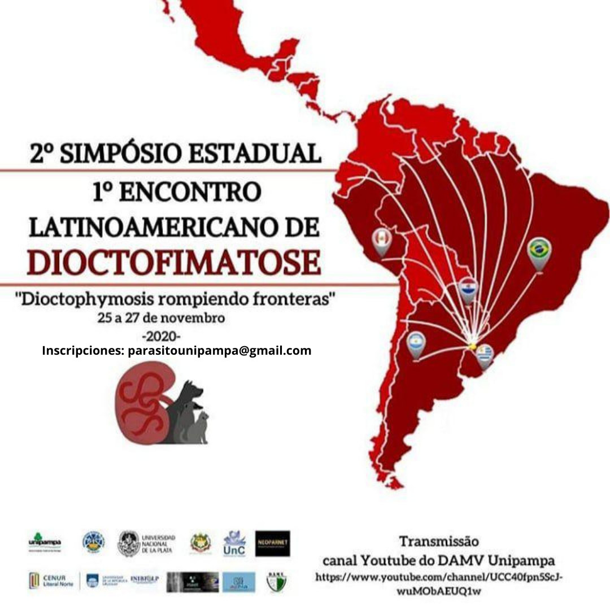

Del **25 al 27 de noviembre de 2020** se realizará el **1.º Encuentro Latinoamericano de Dioctophymosis**, con el lema **«Dioctophymosis rompiendo fronteras»**.

La dioctophymosis es una parasitosis causada por el nematodo *Dioctophyme renale*, conocido como el «gusano gigante del riñón», que afecta principalmente a perros y otros mamíferos. El encuentro, organizado desde la Universidad Federal de Pampa (Unipampa, Brasil), reúne a especialistas de la región para compartir experiencias sobre esta enfermedad.

La transmisión será por el canal de YouTube del DAMV-Unipampa. **Inscripciones:** parasitounipampa@gmail.com
