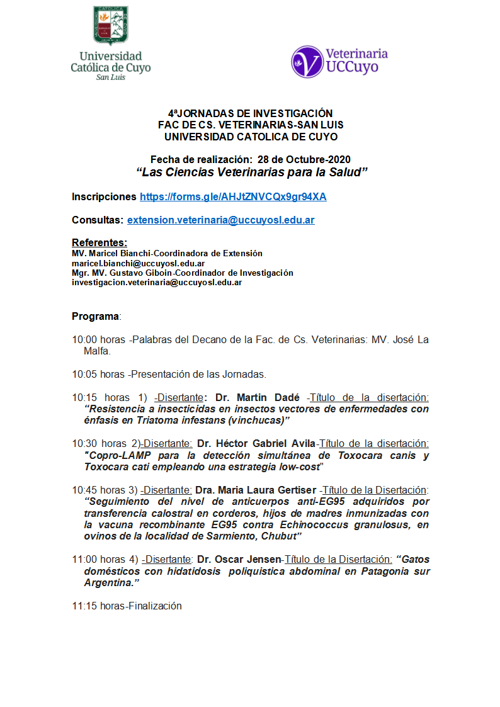
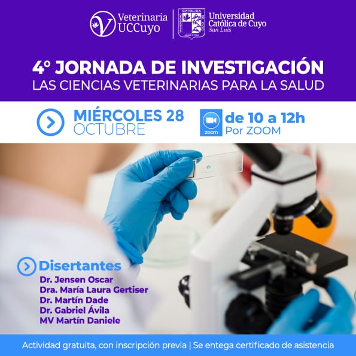

La Facultad de Ciencias Veterinarias de la **Universidad Católica de Cuyo, sede San Luis**, realizará el **miércoles 28 de octubre de 2020, de 10 a 12 h**, su **4.ª Jornada de Investigación**, bajo el lema **«Las ciencias veterinarias para la salud»**.

La actividad es **gratuita, por Zoom, con inscripción previa** y entrega de certificado de asistencia.

## Programa

- **10:00** — Palabras del decano, MV José La Malfa, y presentación de la jornada.
- **10:15** — «Resistencia a insecticidas en insectos vectores de enfermedades, con énfasis en *Triatoma infestans* (vinchucas)». Dr. Martín Dadé y MV Martín Daniele.
- **10:30** — «Copro-LAMP para la detección simultánea de *Toxocara canis* y *Toxocara cati* empleando una estrategia low-cost». Dr. Héctor Gabriel Ávila.
- **10:45** — «Seguimiento del nivel de anticuerpos anti-EG95 adquiridos por transferencia calostral en corderos hijos de madres inmunizadas con la vacuna recombinante EG95 contra *Echinococcus granulosus*, en ovinos de Sarmiento, Chubut». Dra. María Laura Gertiser.
- **11:00** — «Gatos domésticos con hidatidosis poliquística abdominal en Patagonia sur argentina». Dr. Oscar Jensen.

[Programa y horarios de la jornada aquí](/assets/docs/horarios-jornada-veterinaria-san-luis-2020.pdf)

**Inscripción:** [formulario en línea](https://forms.gle/AHJtZNVCQx9gr94XA). **Consultas:** extension.veterinaria@uccuyosl.edu.ar
