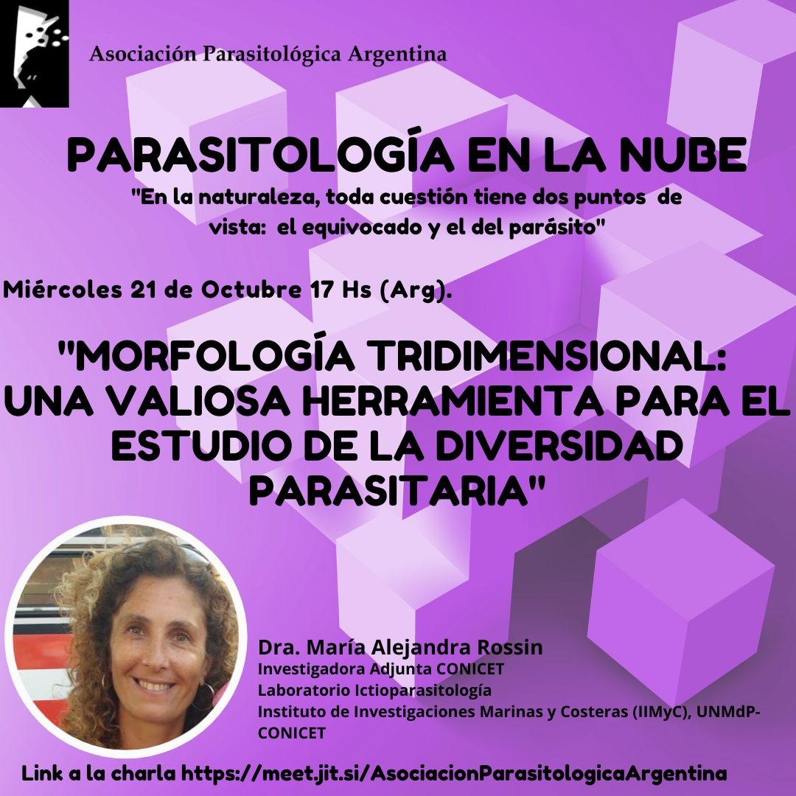

El ciclo **Parasitología en la Nube** de la APA continúa el **miércoles 21 de octubre a las 17 h** con la charla **«Morfología tridimensional: una valiosa herramienta para el estudio de la diversidad parasitaria»**.

La expositora será la **Dra. María Alejandra Rossin**, investigadora adjunta del CONICET en el Laboratorio de Ictioparasitología del Instituto de Investigaciones Marinas y Costeras (IIMyC, UNMdP-CONICET).

Podés ver la charla aquí:


