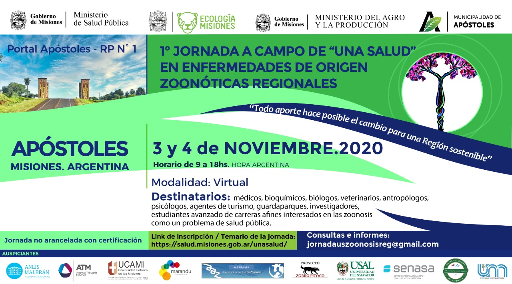

El **3 y 4 de noviembre de 2020, de 9 a 18 h**, se realizará en forma virtual la **1.ª Jornada a campo de «Una Salud» en enfermedades de origen zoonótico regionales**, con transmisión desde el Ministerio de Salud Pública de Misiones.

La jornada, con el lema «Todo aporte hace posible el cambio para una región sostenible», es organizada por profesionales de Apóstoles junto con los ministerios de Salud Pública, de Ecología y del Agro y la Producción de Misiones y la Municipalidad de Apóstoles. Es **no arancelada y con certificación**.

## ¿A quién está dirigida?

A médicos, bioquímicos, biólogos, veterinarios, antropólogos, psicólogos, agentes de turismo, guardaparques, investigadores y estudiantes avanzados de carreras afines interesados en las zoonosis como un problema de salud pública.

**Inscripción y temario:** [salud.misiones.gob.ar/unasalud](https://salud.misiones.gob.ar/unasalud/). **Consultas:** jornadauszoonosisreg@gmail.com
