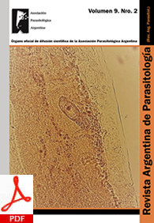

Ya está disponible el **volumen 9, número 2** de la **Revista Argentina de Parasitología (RAP)**, el órgano oficial de difusión científica de la Asociación Parasitológica Argentina.

[Leé el nuevo número aquí](http://www.revargparasitologia.com.ar/revista.html)

## Publicá tu trabajo en la RAP

Invitamos a investigadoras e investigadores a enviar sus artículos para los próximos números. Los requisitos están en las [instrucciones para autores](http://www.revargparasitologia.com.ar/instrucciones.html).
