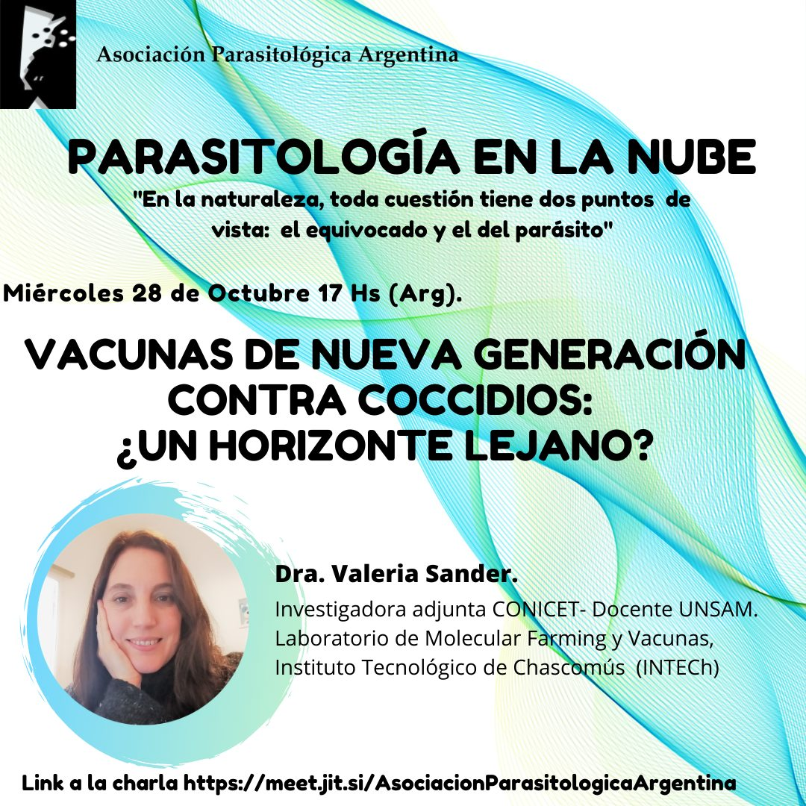

El ciclo **Parasitología en la Nube** de la APA continúa el **miércoles 28 de octubre a las 17 h** con la charla **«Vacunas de nueva generación contra coccidios: ¿un horizonte lejano?»**.

La expositora será la **Dra. Valeria Sander**, investigadora adjunta del CONICET, docente de la UNSAM e integrante del Laboratorio de Molecular Farming y Vacunas del Instituto Tecnológico de Chascomús (INTECh).

Podés ver la charla aquí:


