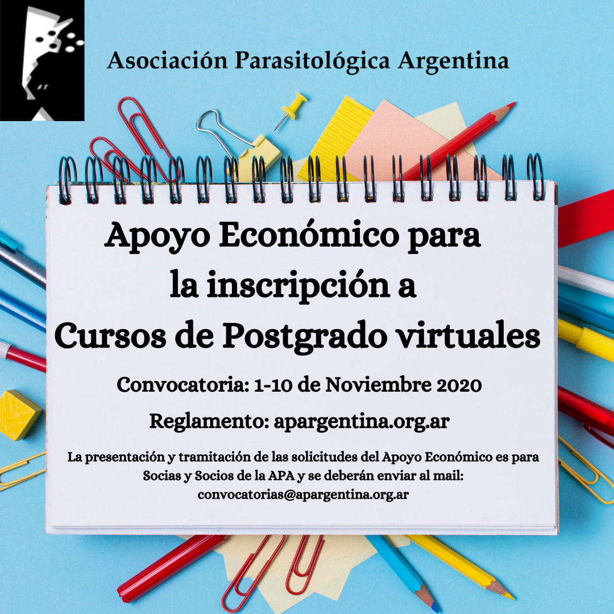

En el contexto del aislamiento social, preventivo y obligatorio, la **Asociación Parasitológica Argentina** abre una **convocatoria excepcional de apoyo económico** para que sus socias y socios puedan inscribirse en **cursos de posgrado virtuales**.

En esta oportunidad se otorgarán **cuatro apoyos económicos**, sujetos a la disponibilidad de fondos de la Asociación.

## Cómo funciona

- **Monto:** equivale a dos cuotas societarias de la categoría profesional y se paga por transferencia bancaria.
- **Uso:** inscripción a cursos de posgrado o capacitaciones, e insumos de librería.
- **Quiénes pueden postularse:** socias y socios activos que estén cursando una carrera de posgrado y tengan la cuota al día. El beneficio puede obtenerse una vez por año.
- **Compromisos:** rendir los gastos a la Tesorería dentro de los 15 días posteriores a la finalización del curso, presentar el certificado y escribir una breve reseña del curso, que se publicará en la web de la APA.

**Período de presentación: del 1 al 10 de noviembre de 2020.** Las solicitudes y consultas se envían a convocatorias@apargentina.org.ar

[Reglamento completo de la convocatoria aquí](/assets/docs/reglamento-apoyo-economico-2020.pdf)
