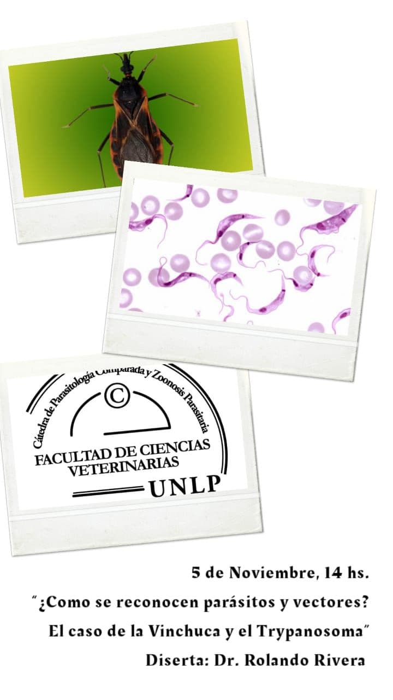

La Cátedra de Parasitología Comparada y el Laboratorio de Parasitosis Humanas y Zoonosis Parasitarias invitan a la charla **«¿Cómo se reconocen parásitos y vectores? El caso de la vinchuca y el *Trypanosoma*»**, el **jueves 5 de noviembre de 2020 a las 14 h**.

Disertará el **Dr. Rolando Rivera**, del Centro de Bioinvestigaciones (UNNOBA-CICBA).

Se entregarán certificados de asistencia. [Ingresá a la charla aquí](https://meet.google.com/pcy-vfxv-sbc)
