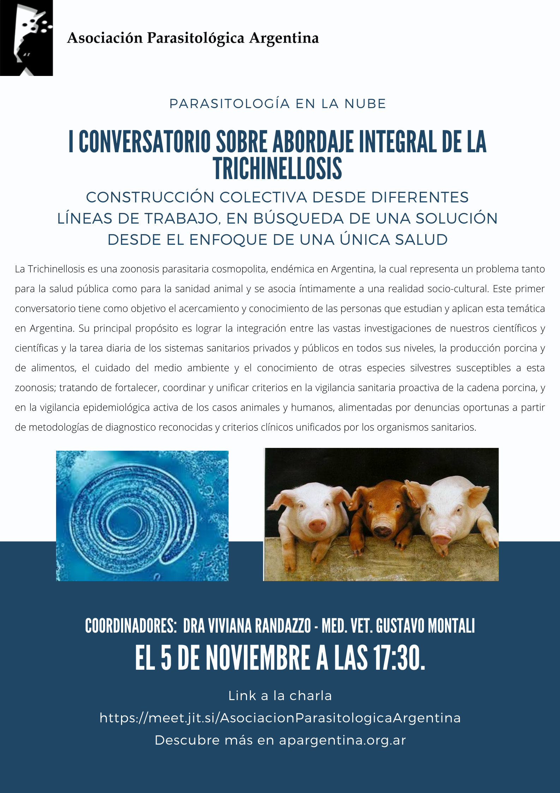

La trichinellosis es una zoonosis parasitaria endémica en Argentina: las personas y muchos animales la contraen al comer carne cruda o mal cocida con larvas del parásito. Aunque se asocia sobre todo al cerdo doméstico, hoy se sabe que también puede transmitirse por la carne de jabalíes, pumas y otras especies silvestres.

Para abordarla desde todos los frentes, la APA organiza el **I Conversatorio sobre abordaje integral de la trichinellosis: construcción colectiva desde diferentes líneas de trabajo, en búsqueda de una solución desde el enfoque de Una Única Salud**. El primer encuentro será el **jueves 5 de noviembre a las 17:30 h**.

## Un espacio para integrar saberes

El objetivo es que se conozcan quienes estudian y trabajan con la trichinellosis en el país, y tender puentes entre la investigación científica y la tarea diaria de los sistemas de salud, la producción porcina, el cuidado del ambiente y el estudio de la fauna silvestre. La meta: unificar criterios en la vigilancia de la cadena porcina y en la vigilancia epidemiológica de casos animales y humanos.

Participan equipos de universidades nacionales, el Laboratorio de *Trichinella* y Trichinellosis del INEI-ANLIS «Dr. Carlos G. Malbrán», especialistas del INTA y el SENASA, representantes de la agricultura familiar, médicos especialistas y miembros de los ministerios de Salud y de Producción.

**Coordinan:** Dra. Viviana Randazzo y MV Gustavo Montali.

[Más información y cronograma del conversatorio aquí](/assets/docs/programa-conversatorio-i-trichinellosis.pdf)

[Ingresá al conversatorio aquí](https://meet.jit.si/AsociacionParasitologicaArgentina)
