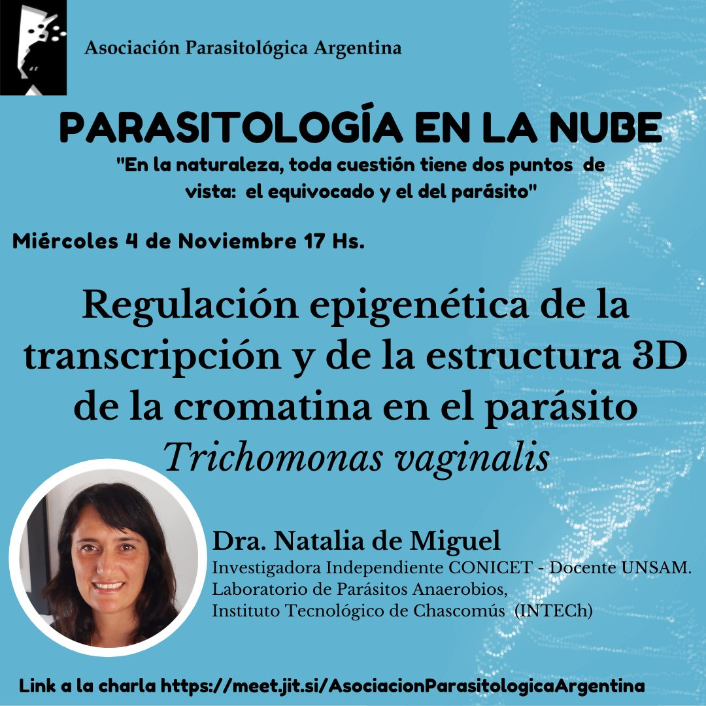

El ciclo **Parasitología en la Nube** de la APA continúa el **miércoles 4 de noviembre a las 17 h** con la charla **«Regulación epigenética de la transcripción y de la estructura 3D de la cromatina en el parásito *Trichomonas vaginalis*»**.

La expositora será la **Dra. Natalia de Miguel**, investigadora independiente del CONICET, docente de la UNSAM e integrante del Laboratorio de Parásitos Anaerobios del Instituto Tecnológico de Chascomús (INTECh).

Podés ver la charla aquí:


